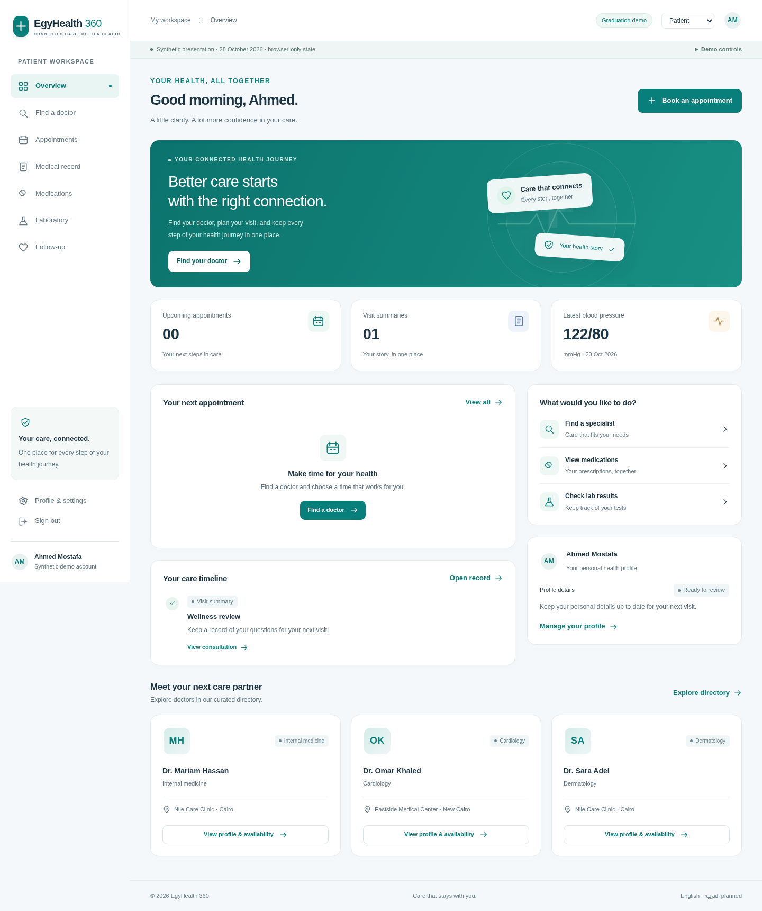
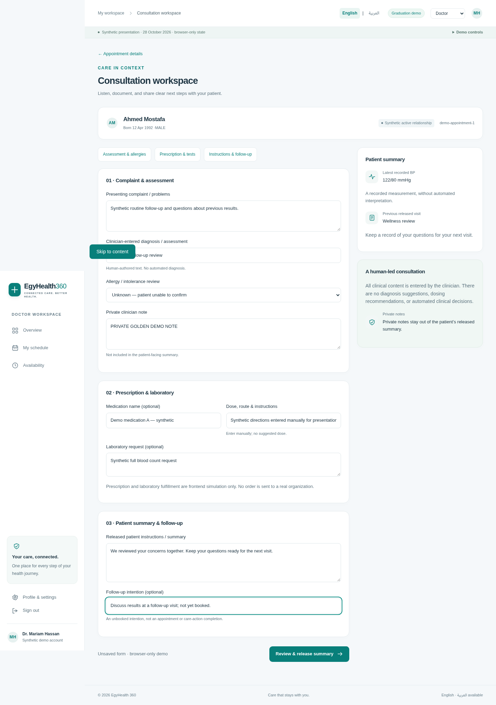

# V3 graduation UI candidate

Current frontend follow-on: [UI / Live delivery accelerator](V3_UI_LIVE_ACCELERATOR.md), based on verified main `4cb20b39370e5317eba14c4916517b6ae88c12e5`. PR #59 merged at `b97bd990644aef1e0de77098b139597adb2fbf0f`; older OPEN/UNMERGED statements below are historical review snapshots. Backend scope is unchanged.

Current bounded follow-on: [UI Phase 5 Stage B clinical documentation](V3_UI_PHASE5_DOCUMENTATION.md) integrates the merged real Slice 5 document/private-signing/explicit-summary-release/amendment/restriction and released-reader routes. Actual Browser → Next → Nest → PostgreSQL proof supplements the separate controlled presentation workspace. Existing Live Booking/Opening and Graduation Demo remain separate. PR #59 is OPEN / UNMERGED; DO NOT MERGE.

Branch: `feat/v3-ui-demo-shell`. Scope: [Issue #51](https://github.com/abuhmaid28/egyhealth360/issues/51), Product Owner's explicit 27 October 2026 session authorization. Starts from verified main `925c4f7bb02d9ee7e6ee443ad290bc70c343fc47`, [push/main Bootstrap SUCCESS](https://github.com/abuhmaid28/egyhealth360/actions/runs/40519168675). This unfreezes only the graduation frontend. PR #50, backend implementation, OpenAPI, schemas, migrations, seeds, clinical rules and backend governance are unchanged. This candidate is for review, not automatic merge or real-patient deployment.

## Current integration — PR #57

[UI Phase 4](V3_UI_PHASE4_CONSULTATION_OPENING.md) integrates independently merged Slice 4 **Consultation Opening only** under an existing current clinical relationship. Normal Live mode sends the merged opening command and shows safe metadata. Phase 5 now integrates real clinical documentation separately; later workflows remain Demo-only. Booking grants zero clinical authority. Review readiness remains gated on required successful CI.

## Real Booking integration — PR #55

[UI Phase 3 + Real Booking](V3_UI_REAL_BOOKING.md) integrates the independently merged Slice 3 APIs after a normal main merge. Live availability now leads to **Real Booking** with own history/detail/cancel/reschedule and exact clinician schedule/attendance/correction. The complete clinical Golden Demo remains separate and browser-only. Booking grants zero clinical authority. Older PR #52 evidence below records the earlier availability-only integration.

## Availability integration update — PR #52 (historical)

The same UI branch now includes a normal merge of current main **`9252a1f06b9a851c09b7410882f9e4c0fddd4c53`**, containing approved PR #50 / V3-I2 Slice 2. Pre-mutation gate: PR #52 OPEN/unmerged at `5424b65e50b4ca16e06bd4136e98cbb0c111a3f3`, clean worktree, exact expected main, no competing UI PR. Merge commit `0533d560f13709c2cf876ec713c2ed8ff81553d0` preserves both parents. README/PROJECT conflicts were resolved by keeping main's backend status and the separate UI authorization note. Backend files, migrations, OpenAPI and Slice 2 tests are inherited unchanged from main, not modified by this integration.

At the PR #52 review point, live availability/publication/withdrawal were **IMPLEMENTED / IN REVIEW**, and Booking onward remained frontend-only. V3-I2 Slice 3 backend is separately AUTHORIZED under [Issue #48 comment 6458202424](https://github.com/abuhmaid28/egyhealth360/issues/48#issuecomment-6458202424), but it is not implemented or completed by this UI PR. This UI task grants no backend authority and does not expand Slice 3 scope. No backend booking/consultation/fulfillment or clinical authority is introduced. Exact-head Bootstrap evidence is recorded in PR #52 after completion; the PR stays OPEN / UNMERGED.

## Run and present

Use repository-pinned Node **24.21.0** and pnpm **10.34.6**:

```sh
pnpm install --frozen-lockfile
pnpm generate
pnpm build
pnpm --filter @egyhealth/web start
```

Open `http://localhost:3000` and choose **Explore the patient demo**. No API, database, password or backend seed is needed for the demo. **Sign in with live account** is a separate path using the actual backend session. The mode indicator always identifies Graduation demo vs Live API; no silent fallback exists.

Demo controls in the thin presentation bar let reviewers preview populated/loading/empty/error states and reset the journey. Data is synthetic, deterministic and fixed to **28 October 2026**, not wall-clock “today.” Cairo uses **+03:00** on the demo dates; time display uses `Africa/Cairo`. The demo fixture uses 28–29 October before the daylight-saving transition. The shared publication form accepts explicit-offset ISO timestamps; live publication resolves and validates the authoritative clinic configuration on the server. No browser timezone or hardcoded Cairo offset is appended to live requests.

## Live availability → Real Booking

Sign in with a real synthetic PATIENT account, discover a published provider, filter by clinic and choose a published time. Dates use each stored IANA timezone. Live review collects no clinical reason and submits only `{slotId, operationKey}` to the merged Booking API. Confirmation opens the real booking detail; My Bookings supports own paginated history, cancel and same-clinician/clinic reschedule. The clinician sees only the exact operational schedule, with explicit attendance/no-show and appended correction. All operations stay Live on error; no Demo fallback or clinical authority is created. See the [exact contract, replay behavior and proof](V3_UI_REAL_BOOKING.md).

## Golden Demo

1. Enter the Patient demo as Ahmed Mostafa; open **Find a doctor**.
2. Search for **Mariam**, review Internal medicine, Nile Care Clinic, and the doctor profile. Clinic details are linked from the profile.
3. Select a time, enter a reason, review the modal, and confirm. The appointment appears in details and the dashboard.
4. Use **Demo workspace → Doctor**. Dr. Mariam sees the appointment; open the patient, then the consultation workspace.
5. The fixture already has an active synthetic Ahmed–Mariam care relationship. This is independent of booking: no authorization, acceptance, assignment or backend grant is created. Bookings with the other directory doctors do not appear in Mariam's schedule or open in her consultation workspace.
6. Enter complaint, assessment, explicit allergy-review state, optional private note, optional medication/directions, optional lab request, patient instructions and unbooked follow-up intention. All clinical text is entered manually; nothing recommends a diagnosis or dose.
7. Review and release the demo summary. Release completes the demo appointment. Private notes remain out of the patient projection; released summaries cannot be overwritten by another release.
8. Optionally switch to Pharmacy: received → preparing → full-item dispensed. Switch to Laboratory: requested → in progress → human-entered result ready. State is maintained separately per consultation artifact.
9. Return to Patient: record, consultations, medication status, laboratory result and unbooked follow-up show the continuous journey. Reload retains the browser demo. Reset returns exactly to the original fixtures.

The simulation does not constitute backend Journey A exit proof. No backend booking, consultation, prescription, laboratory result, consent or dispensing persistence is claimed.

## Architecture

- Existing **Next.js 16 App Router / React 19 / TypeScript** stack, one application. There was only a bootstrap page; no existing CSS, component library, frontend API client/auth UI, public assets or design implementation to preserve. `packages/ui` remains an untouched scaffold.
- `apps/web/app/[[...path]]/page.tsx`: route entry; Next Link and router navigation preserve shared client state. Unknown and wrong-workspace paths receive a deliberate recovery view. No second frontend framework.
- `src/components/application.tsx`: responsive shared sidebar/header/footer, session bootstrap, fixed role navigation, explicit demo/live entry and role switch restricted to demo.
- `src/components/ui.tsx`: cards, badges, forms, details, avatars, icons, resource boundary, skeleton/empty/error/loading patterns. Native modal dialogs provide focus containment and Escape handling. Keyboard focus, skip link, reduced-motion support and accessible form labels are included.
- `app/globals.css`: named CSS custom-property tokens for color, radius, spacing conventions and typography; layouts adapt to desktop, tablet and mobile. Illustrations/icons use local CSS/SVG with no external assets, image tracking or paid fonts.
- `src/lib/api/contracts.ts`: typed frontend contracts; separate exact public directory and frozen seven-field availability projection. UI-only appointment/consultation/fulfillment contracts do not declare new backend contracts.
- `src/lib/api/availability.ts`: strict public seven-field / separate own-history projection, envelope validation and safe malformed-response errors; never spreads internal upstream fields into presentation or demo storage.
- `src/components/availability.tsx`: shared paginated public selector and own-clinician history/publication/withdrawal controls.
- `src/lib/api/live.ts`: credentialed, same-origin, no-store HTTP adapter. Backend HttpOnly session cookie stays browser-managed; CSRF comes from login/me and stays in memory. Identity/role come from the server. Profile writes contain only the three permitted context fields.
- `src/lib/mock/{fixtures,adapter}.ts`: all synthetic data and state transitions. Storage key `eh360-ui-demo-v1` is browser-only JSON; no remote write, backend fixture, shared seed or database model. State controls are a presentation feature, not backend authorization.
- `next.config.ts`: same-origin `/api/v1/*` rewrite to the existing API. Set **`EH_UI_API_ORIGIN` at build time** if not using the default `http://127.0.0.1:3001`. For Compose networking use `http://api:3001` at web build time. No backend CORS or CSRF weakening; configure backend `AUTH_BROWSER_ORIGIN` to the exact browser origin. Existing Compose files are unchanged.

English and Arabic/RTL are supported by the separate [UI Phase 2 implementation](V3_UI_AR_RTL.md), with a locally persisted presentation-only language switch. Clinical/free-text content remains verbatim; backend timezone semantics and live/demo boundaries are unchanged.

## Screens and routes

| Workspace      | Implemented routes / screens                                                                                                                                                                                                    |
| -------------- | ------------------------------------------------------------------------------------------------------------------------------------------------------------------------------------------------------------------------------- |
| Entry          | `/`, `/login`: polished auth shell, explicit live sign-in and synthetic demo entry                                                                                                                                              |
| Patient        | `/patient`: dashboard, next visit, timeline, measurements and care partners                                                                                                                                                     |
| Discovery      | `/patient/discover`: name search on the returned public page, specialty and clinic filters; `/patient/doctors/:id`: profile/clinic/availability/review/booking; `/patient/clinics/:id`: address and doctors                     |
| Appointments   | `/patient/appointments`: upcoming/completed; `/patient/appointments/:id`: confirmation, details and record link                                                                                                                 |
| Record         | `/patient/record`, `/patient/history`, `/patient/medications`, `/patient/laboratory`, `/patient/follow-up`: released summaries, consultations, prescriptions, tests/results, follow-up intentions                               |
| Settings       | `/patient/settings`: own profile read/edit and privacy context                                                                                                                                                                  |
| Doctor         | `/doctor`, `/doctor/schedule`, `/doctor/availability`: dashboard, upcoming/completed schedule, finite interval publication                                                                                                      |
| Consultation   | `/doctor/appointments/:id`: logistics and separate relationship context; `/doctor/consultation/:id`: patient summary, assessment, allergies, private notes, prescription/lab fields, instructions, review/release and follow-up |
| Pharmacy       | `/pharmacy`: routed prescription inbox, details and preparation/full-item dispensing                                                                                                                                            |
| Laboratory     | `/laboratory`: request inbox, details, processing, result entry and release                                                                                                                                                     |
| Admin          | `/admin`, `/admin/organizations`, `/admin/users`, `/admin/directory`, `/admin/scheduling`: operational overview/tables/read-only configuration overview; no clinical navigation or clinical payload                             |
| Other settings | `/doctor/settings`, `/pharmacy/settings`, `/laboratory/settings`, `/admin/settings`: bounded workspace/privacy context                                                                                                          |

## Live vs demo mapping

| Capability                                                   | Live adapter on integrated main                                                                                                                                                     | Demo adapter                                                               |
| ------------------------------------------------------------ | ----------------------------------------------------------------------------------------------------------------------------------------------------------------------------------- | -------------------------------------------------------------------------- |
| Auth                                                         | POST `/auth/login` (`X-EH-Login: 1`), GET `/auth/me`, POST `/auth/logout` (session CSRF and exact empty JSON object); paths beneath `/api/v1`                                       | Explicit synthetic workspace session, separate from backend cookie         |
| Discovery                                                    | GET `/directory/specialties`, `/directory/clinics`, `/directory/providers`, `/directory/providers/{publicId}`                                                                       | Deterministic curated directory                                            |
| Own patient profile                                          | GET/PUT `/me/profile`; server-derived ID is read-only; full replacement of displayName/dateOfBirth/sex only                                                                         | Browser profile edits                                                      |
| Existing medical record                                      | Own profile-derived GET `/patients/{id}/blood-pressure-measurements`, `/clinical-encounters`, `/follow-up-appointments`; no client-selected target and no management/clinical write | Synthetic measurement and prior released wellness summary                  |
| Public availability                                          | Live Slice 2 GET, clinic filter and page navigation; no-store, no fallback                                                                                                          | Deterministic synthetic slots with the same seven-field projection         |
| Clinician availability                                       | Live own history, finite publication and terminal withdrawal                                                                                                                        | Deterministic own publication/withdrawal simulation                        |
| Booking / clinician schedule                                 | Merged Slice 3 real logistics read/write adapter                                                                                                                                                       | Browser-only appointment state; own clinician fixture schedule             |
| General consultation / private notes / released instructions | Merged Slice 5 immutable drafts/private signing and explicit patient-summary release; own/current-related released readers, amendments and restriction. See Phase 5. | Human-entered demo form, review/release, private-note exclusion |
| Prescription / lab / dispensing / general follow-up intent   | Not integrated; no network write                                                                                                                                                    | Per-artifact browser workflow; not EH-012 records or CareAction completion |
| Operational management                                       | Existing services are internal, not invented browser endpoints; adapter reports not integrated                                                                                      | Read-only operational fixtures, no ADMIN clinical access                   |

Directory collections read the first bounded page (100), and medical history reads the first page (20). Public and own availability expose page navigation (20 per page). Search/filter operates over that returned directory page. Complete server-paginated browsing, cancellable requests and independent per-source live-record retries are later UI integration work. No rating, licensing verification, fee, occupancy count or public patient data is invented.

## Exact Slice 2 HTTP mapping

All paths below are beneath the same-origin `/api/v1` rewrite. Publication and withdrawal are restricted to the server-derived current clinician, with existing cookie/Origin/Fetch Metadata/session CSRF. Admin remains denied clinician/clinical operations.

| Endpoint                                           | Request / result                                                                                                                                                                                                                                                                                     |
| -------------------------------------------------- | ---------------------------------------------------------------------------------------------------------------------------------------------------------------------------------------------------------------------------------------------------------------------------------------------------- |
| GET `/directory/providers/{publicId}/availability` | Public identical all-role projection. UI sends canonical `page` and `pageSize=20`, optional `clinic`. Adapter also supports paired explicit-offset `from`/`to`; backend caps span at 90 days. Result `{data:[{id,providerId,clinicId,startAt,endAt,timeZone,bookable}],meta:{page,pageSize,total}}`. |
| GET `/me/availability`                             | Own history, `page`, `pageSize=20`; result `{data:[{id,providerId,clinicId,startAt,endAt,timeZone,state,version,publishedAt,withdrawnAt}],meta}`. No patient, internal identity or operation fields.                                                                                                 |
| POST `/me/availability`                            | Exact JSON `{clinicId,startAt,endAt,operationKey}`; 200 `{data:ownSlot}` including exact replay. No caller timezone, configuration, user/provider identity, capacity or status field.                                                                                                                |
| PUT `/me/availability/{slotId}/withdraw`           | Exact JSON `{operationKey,expectedVersion}`; 200 `{data:ownSlot}`, terminal WITHDRAWN. Operation key is retained across same-form retries, as is the publish key for unchanged input.                                                                                                                |

Public and own collections also support HEAD; the UI uses GET. Every response is `Cache-Control: no-store`, no ETag/Last-Modified/304. Public pagination: page 1–10000, size 1–100; defaults 1/20. Public provider ineligibility is `DIRECTORY_NOT_FOUND`/404; eligible empty availability is 200 with an empty page. Safe backend errors include 400 REQUEST_INVALID, 401 AUTH_UNAUTHENTICATED, 403 AUTH_CSRF_INVALID, 404 AVAILABILITY_NOT_FOUND, 409 AVAILABILITY_CONFLICT, 413 REQUEST_TOO_LARGE, 415 REQUEST_CONTENT_TYPE_INVALID and 503 AVAILABILITY_UNAVAILABLE as applicable. UI messages explain validation/conflict/service errors without reflecting raw backend payloads.

Clinician publication offers the existing public clinic catalog, then relies on the server to validate current membership/publication eligibility. There is no HTTP endpoint for scheduling configuration or current clinic membership; the form does not invent one. Users supply explicit-offset ISO instants matching the clinic's configured timezone and exact duration. Timezone, duration, lead and horizon validation stays authoritative on the server. History labels distinguish Published from Withdrawn, without claiming every published historical slot is currently bookable. No recurrence, automatic schedule generation, settings mutation, booking or clinical authority is added.

## Validation and dependency

Pinned **Playwright 1.64.1** is the sole new dependency, **development only**. It is actively maintained, Apache-2.0, and enables real-browser navigation, modal, state, persistence, privacy and responsive checks unavailable in the prior scaffold. No application runtime dependency was added. Browser installation adds CI tooling, not a deployed service. Existing CI checks are retained; browser regression steps are additive.

```sh
pnpm lint
pnpm typecheck
pnpm build
node --test tests/*.test.mjs
pnpm test:ui
pnpm exec playwright install --with-deps chromium
pnpm test:ui:browser
# Disposable DATABASE_URL and free loopback ports 3000/3001 are required:
pnpm test:ui:real
pnpm audit --prod --audit-level high
pnpm audit --audit-level high
```

`tests/ui-demo.test.mjs` compiles the pure adapters with existing TypeScript and tests the continuous journey, reset/slot determinism, duplicate booking, seven-field availability projection/timezone, own clinician scope, private notes, release immutability, ADMIN/staff separation, artifact status scoping, overlap handling, live route/CSRF shape and explicit unavailable capabilities. The current frontend suites include **22 demo/compatibility adapter tests**, **19 Live Booking tests** and **2 localization tests**. Live Booking retry, privacy, lifecycle and projection coverage is described in [the current integration guide](V3_UI_REAL_BOOKING.md). These tests are included in the existing root test glob.

`scripts/test-ui-browser.mjs` starts the production-built Next app on loopback port 3100. It tests the complete Golden Demo, patient privacy, refresh continuity, all 23 main route state variants, desktop/tablet/mobile navigation/overflow, ADMIN boundary and a separately stubbed live HTTP login/logout contract probe. The live probe is **not** proof against a real database/API. `EH_UI_CHROMIUM=/path/to/chromium` optionally uses a system browser. `UI_SCREENSHOT_DIR=docs/ui-screenshots` regenerates screenshots. The stubbed browser matrix additionally covers live availability success/loading/empty/failure, pagination, non-bookable rows, clinic-local New York time with a Tokyo browser, long names at desktop/tablet/mobile sizes, real Booking review and zero-clinical-continuation boundaries, own clinician publish/withdraw, backend errors and stable operation keys. No live credentials or real clinical payloads are used in these stubbed tests.

`scripts/test-ui-availability-real.mjs` / `pnpm test:ui:real` provides actual browser → Next rewrite → Nest API → PostgreSQL proof using existing isolated Booking/availability fixtures, generated synthetic credentials and disposable databases. It covers publication/overlap/withdrawal, public timezone, real Booking create/history/detail/reschedule/cancel after provider unpublication, exact clinician schedule, explicit attendance/no-show and correction with retained history. It asserts zero assignments/relationships/clinical encounters and no clinician clinical queries. Timing fixture and independent real-clock proof boundaries are documented in [the current guide](V3_UI_REAL_BOOKING.md). It requires free ports 3000/3001, cleans up its own web/proxy/database resources and remains in the unchanged Bootstrap test:ui:real step.


Local results and remote PR CI evidence are recorded in the PR handoff. Backend integration/migration/container gates remain unchanged and run in Bootstrap CI; frontend simulation never substitutes for those gates.

## Screenshots





[Auth](ui-screenshots/01-login.png) · [Discovery](ui-screenshots/03-discovery.png) · [Doctor profile](ui-screenshots/04-doctor-profile.png) · [Booking review](ui-screenshots/05-booking-review.png) · [Confirmation](ui-screenshots/06-booking-confirmed.png) · [Doctor dashboard](ui-screenshots/07-clinician-dashboard.png) · [Pharmacy](ui-screenshots/09-pharmacy.png) · [Laboratory](ui-screenshots/10-laboratory.png) · [Patient record](ui-screenshots/11-patient-record.png) · [Admin](ui-screenshots/12-admin-operations.png) · [Mobile dashboard](ui-screenshots/13-mobile-dashboard.png) · [Mobile discovery](ui-screenshots/14-mobile-discovery.png) · [Tablet](ui-screenshots/15-tablet-dashboard.png)

## Remaining work and integration dependencies

The primary demo has no “coming soon” pages. Lighter portals deliberately omit deep organization/user/publication editing, generic IAM, inventory, partial dispensing, full LIS/PACS and medical-record browsing by staff/Admin. Consultation corrections/addenda, draft persistence, real clinician onboarding, enrollment UX and deep operational management remain later bounded frontend slices. The current clinician demo is Dr. Mariam only; the other public providers demonstrate directory breadth.

Availability is integrated with merged Slice 2. Booking/schedule is now integrated through merged Slice 3; next connect separately established current clinical authority, general consultation/release/corrections, and the I3 artifact-routing/fulfillment contracts as those slices are authorized and delivered. Revalidate all identity, assignment, revocation, expiry, wrong-patient, privacy and staff artifact scope on the backend; local demo guards are not security enforcement. No admin clinical entitlement, clinical rule, autonomous diagnosis, medication suggestion, treatment policy or EACCE bridge is introduced here.

New availability screenshots: [Live public desktop](ui-screenshots/16-live-availability-desktop.png) · [Mobile](ui-screenshots/17-live-availability-mobile.png) · [Tablet](ui-screenshots/18-live-availability-tablet.png) · [Clinician publication/history](ui-screenshots/19-live-clinician-availability.png). These four presentation captures use controlled HTTP fixtures; real API execution is proven separately by `test:ui:real`.

Phase 3: [presentation polish, booking service separation and validation](V3_UI_PHASE3_POLISH.md). The [Real Booking continuation](V3_UI_REAL_BOOKING.md) integrates merged Slice 3; the separate clinical Golden Demo remains browser-only.
