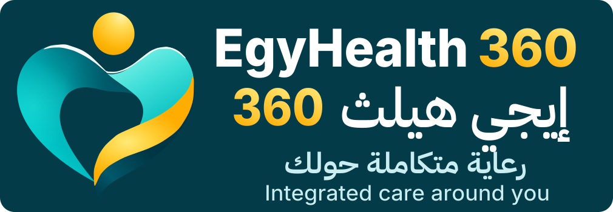
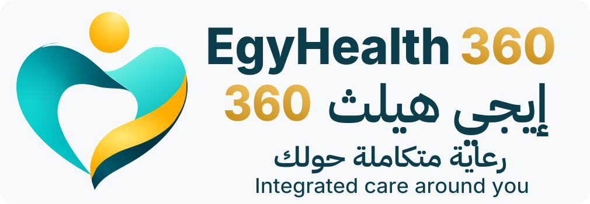
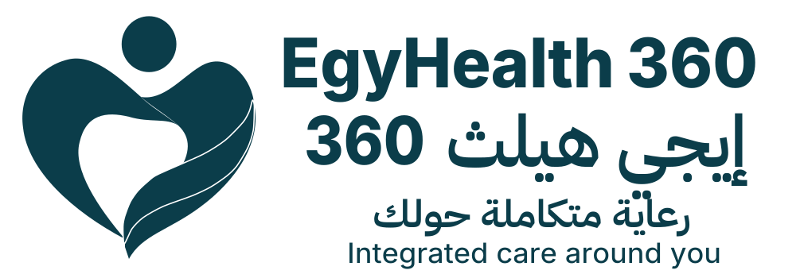

# Logo usage foundation

All linked artwork is copied unchanged from PR #96 head `cb3fd9112f15e17b3d500d7a9dd085dd6e412525`. Guidance below is recommended for owner review. It is not a new export approval or a claim that deferred Arabic fit/copy is resolved.

## Supplied artwork

| Use | Preserved asset |
| --- | --- |
| Primary / dark full bilingual lockup | [lockup-dark.svg](assets/lockup-dark.svg) |
| Light full bilingual lockup | [lockup-light.svg](assets/lockup-light.svg) |
| Monochrome full lockup | [lockup-mono.svg](assets/lockup-mono.svg) |
| Transparent standalone master | [symbol-primary.svg](assets/symbol-primary.svg) |
| Standalone with background | [Dark](assets/icon-dark.svg), [Light](assets/icon-light.svg), [Monochrome](assets/icon-mono.svg) |
| App icon | [SVG](assets/app-icon-512.svg), [actual 512×512 PNG](evidence/app-icon-512.png) |
| Favicons | [32 SVG](assets/favicon-32.svg) / [32 PNG](evidence/favicon-32.png), [24 SVG](assets/favicon-24.svg) / [24 PNG](evidence/favicon-24.png), [16 SVG](assets/favicon-16.svg) / [16 PNG](evidence/favicon-16.png) |

These full lockups retain the current Arabic tagline for traceability only. Final ya dots/interline fit and Egyptian Arabic tagline rewrite remain deferred. All three variants are shown on the owner boards with this limitation nearby.

## Clear space and scale recommendations

Define **x as the floating gold head diameter** (approximately 70 source units in the master). For new placements, propose at least **0.5x free space around the complete symbol bounds** and **1x around the complete full-lockup bounds**, measured after uniform scaling. This is an added spacing recommendation, not an established measurement in the raster board. Never count the symbol's internal cavity or head gap as external clear space. Existing app/favicon canvases retain their existing internal padding and are separate fixed specimens, not silently repadded master geometry.

| Placement | Starting guidance / practical limit |
| --- | --- |
| Standalone identity | Prefer at least 32px visible symbol height in ordinary UI; 24px only when space constrained and context names the product. Fine shading/rim detail will diminish. |
| Full bilingual + two taglines | Start at 600px artwork width (1010×350 viewBox gives about 208px height), excluding added clear space. Validate actual reading size before use; this is not a certified universal minimum. Do not shrink the full lockup to a 320px mobile header. |
| Favicon 16/24/32 | Use exact size-specific supplied canvases. Native pixels are shown on the board. At 16px retain coarse color/silhouette expectation only, not full folded-material readability. |
| App icon | Use existing 512px square proof. Platform masking, additional size exports and installed-device recognition remain future checks. Keep the gold head and bottom tip inside safe visible area. |
| Print | No validated physical minimum yet. Require actual print proof before final use; monochrome is the supplied one-ink derivative with ribbon-edge knockout. |

Do not edit master contours to compensate for tiny use. A future optical derivative would require separate authorized, labelled geometry and comparison; none is introduced here.

## Background compatibility

Dark primary belongs on calm deep teal/Nile Night-compatible surfaces. Light version belongs on white/light surfaces with its existing darker wordmark gold. Use the supplied monochrome version for one-ink needs; preserve its intentional ribbon separation. The transparent master needs a quiet field and sufficient edge distinction; it is not guaranteed on every arbitrary teal, photo or gradient. Use a backing surface where necessary and prove contrast at actual size. Do not add glow, stroke, drop shadow, extra gloss, rotation or workspace recolors.

The board's presentation shadow/gradient is not a universal product-surface specification. No actual favicon metadata, app manifest, navigation component or runtime asset is replaced. Underlying originality/trademark rights are not certified by this package.
