# EgyHealth 360 — Formal System Diagrams V1

> **V3 applicability:** Historical V1 diagram set; not the current V3 actor/module inventory or proof of implementation. Product V3 approves five future workspaces while retaining the single-application/modular-monolith stack. Existing diagrams are retained unchanged, including old exclusions/lifecycles; current domain/status/roadmap documents and accepted contracts govern. No visual product design or new diagram is introduced. See [approved policy/lineage](../PRODUCT_V3_DECISIONS.md).

These diagrams are architecture/documentation source-of-truth aids. They describe approved boundaries; they are not generated screenshots and do not override detailed requirements or ADRs.

## 1. System context

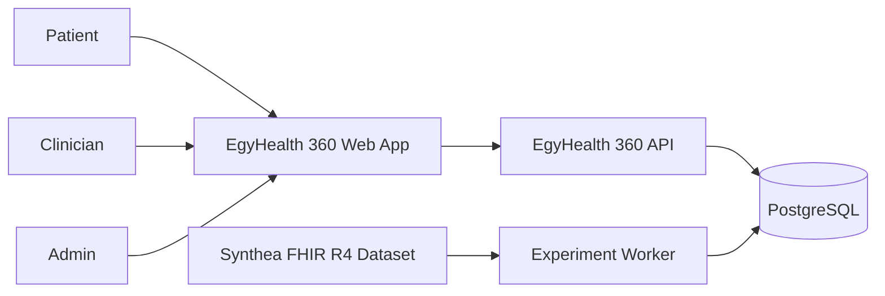

Key boundary: Core V1 has no live hospital/lab/pharmacy integration and no real-patient data dependency.

## 2. High-level component architecture

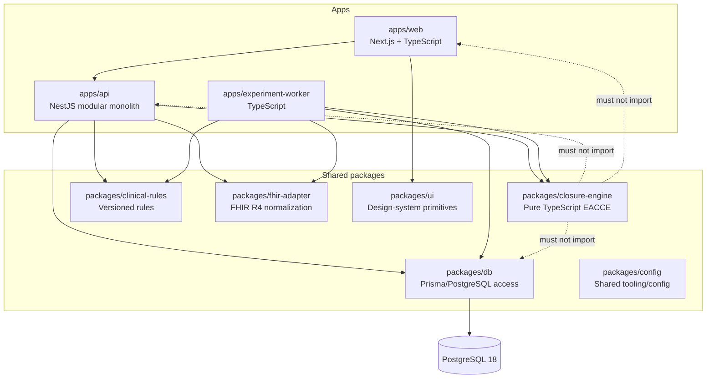

Constraint: `closure-engine` is framework-independent and receives typed inputs only.

## 3. Product-domain boundaries

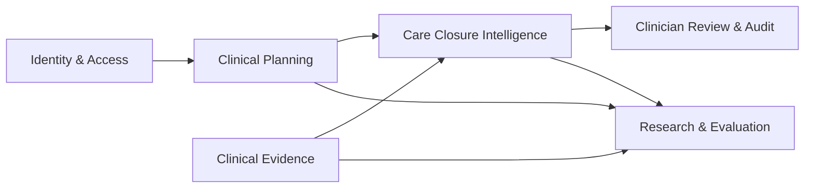

Research consumes versioned domain/rule logic but must not expose benchmark ground truth to product-facing execution.

## 4. Core product evaluation sequence

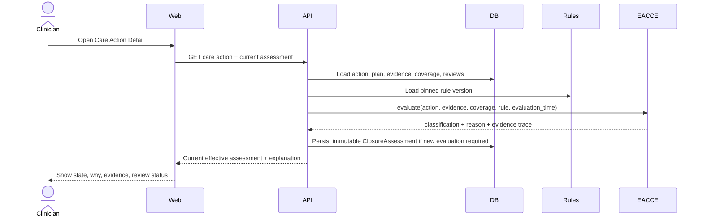

## 5. New-evidence re-evaluation sequence

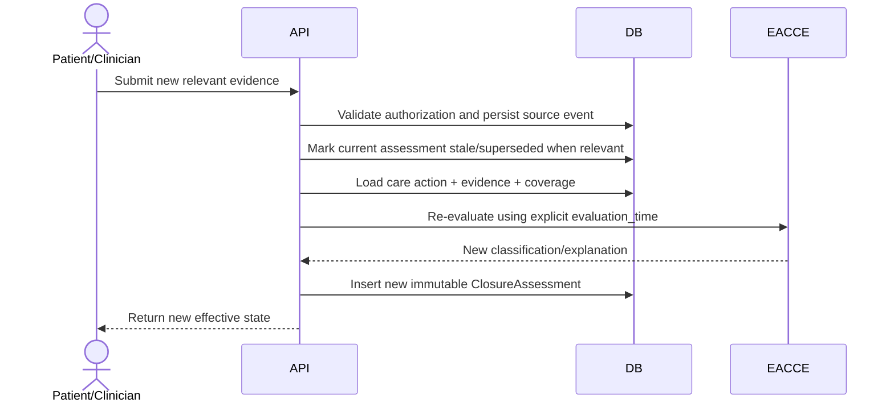

Rule: old assessments are never overwritten.

## 6. Clinician override/review sequence

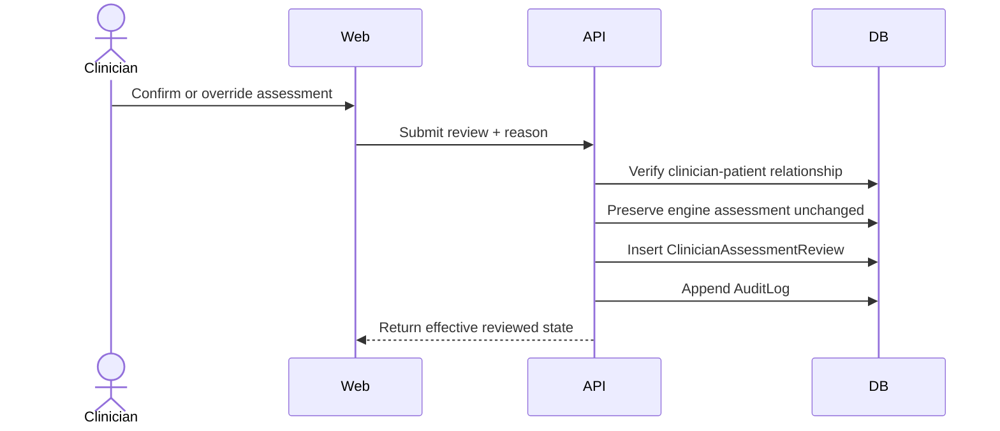

An override changes the effective reviewed status; it does not mutate the original engine result.

## 7. Care plan state machine

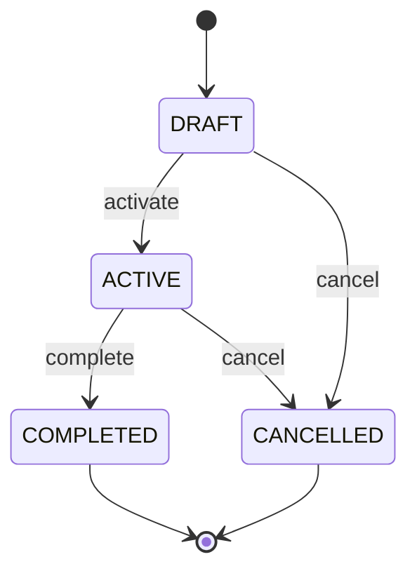

Published/versioned templates are separate from individual patient care-plan lifecycle.

## 8. Care action operational state machine

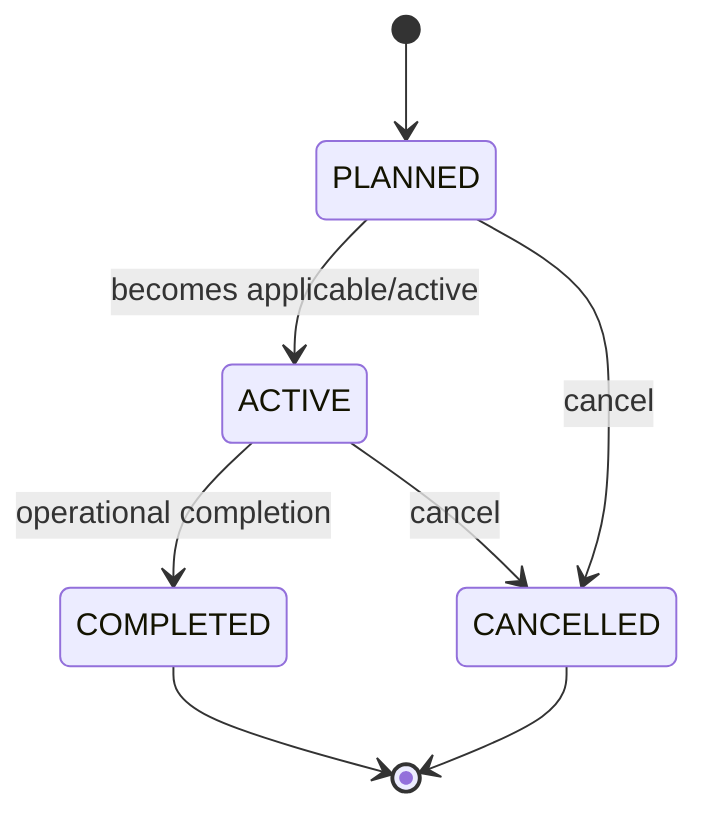

Important: operational status is not the same field as EACCE closure classification.

## 9. Closure classification model

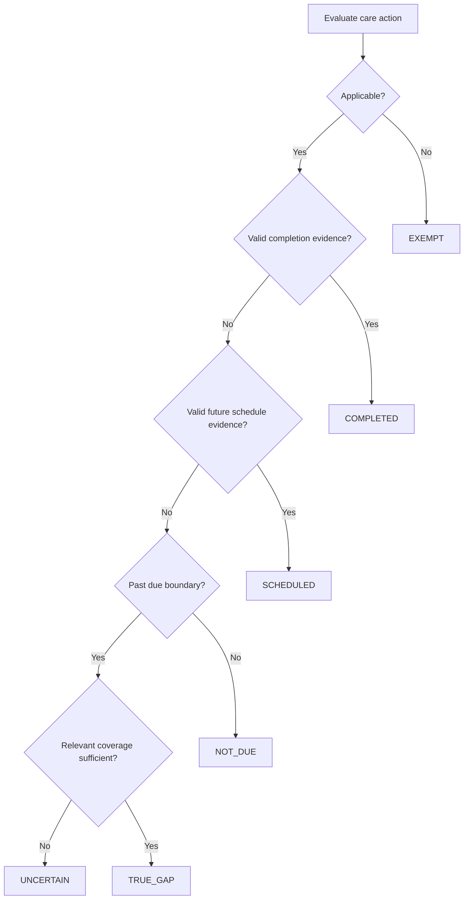

The exact implementation ordering must match the frozen engine contract/tests. Missing evidence alone is never sufficient for `TRUE_GAP` when relevant coverage is known insufficient.

## 10. Closure assessment lifecycle

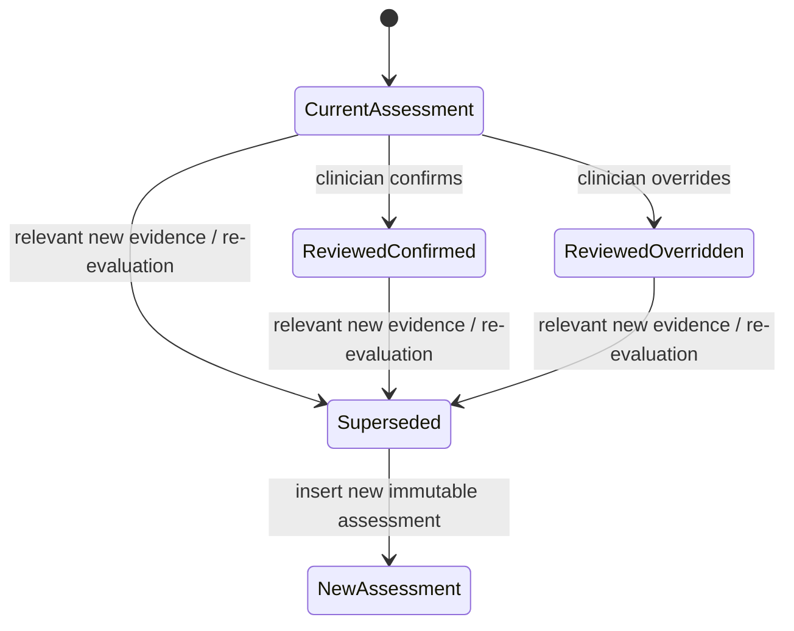

Historical rows remain queryable/auditable.

## 11. Simplified logical ERD

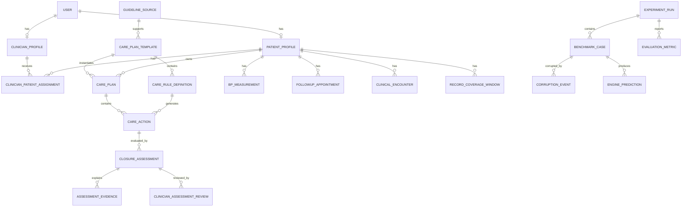

This is conceptual. Executable Prisma constraints remain governed by `DATA_MODEL.md` and future migration issues.

## 12. Research pipeline

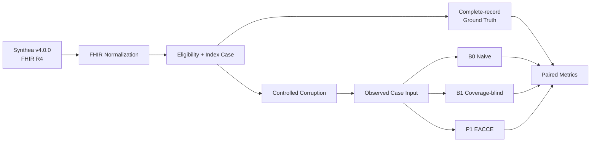

Ground truth is created before corruption and must never flow into method input.

## 13. Ground-truth trust boundary

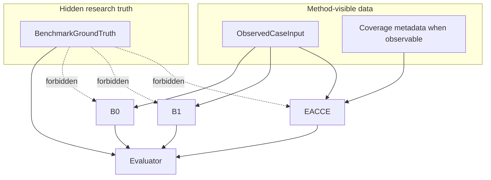

## 14. Authorization/trust boundaries

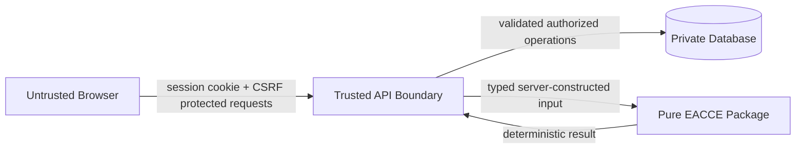

Never trust browser-supplied patient identity, ownership, assessment status, or authorization decisions.

## 15. Local deployment diagram

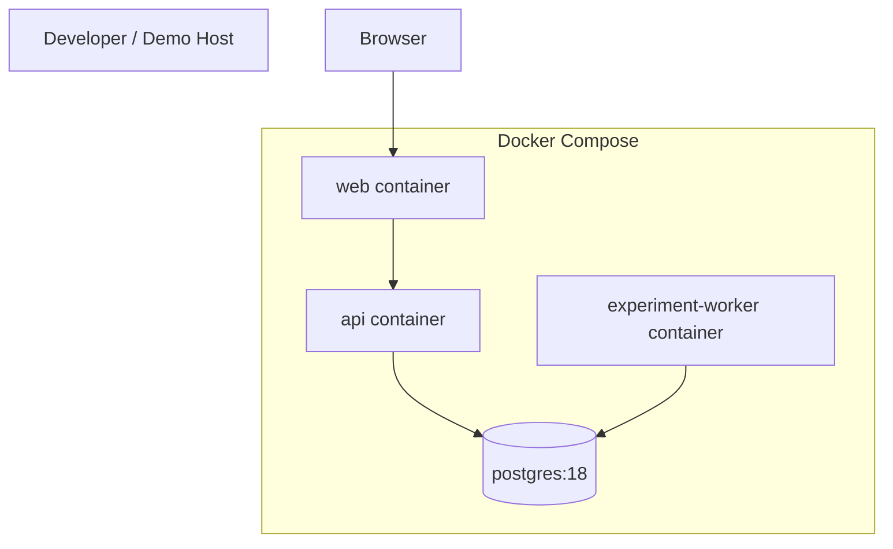

No Kubernetes, Redis, Kafka, RabbitMQ, or paid external service is required for Core V1.

## 16. Use-case overview

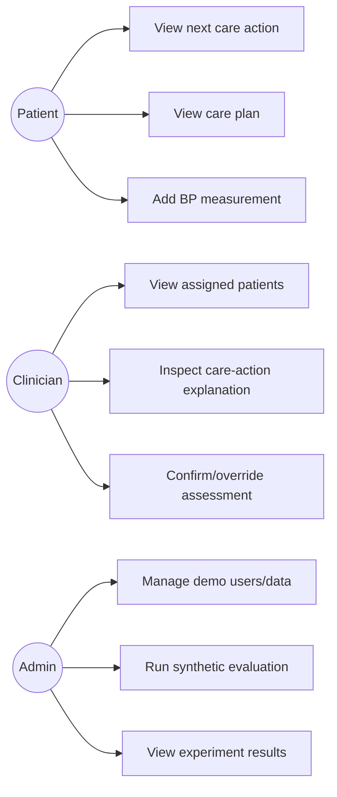

No user role includes diagnosis automation or treatment recommendation.

## 17. Diagram change policy
Any implementation that materially contradicts these diagrams must either:
1. be corrected to match approved architecture; or
2. receive an approved ADR/requirements update and corresponding diagram revision before merge.
