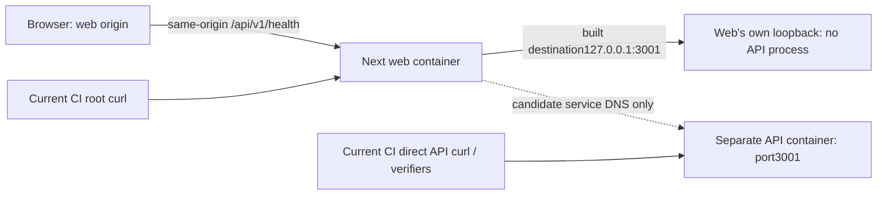

# F06 root cause and evidence provenance

**Issue #120 · DOCUMENTATION / READ-ONLY · no fix, topology selection or new runtime reproduction.** Read [options/regression/rollback](OPTIONS_REGRESSION_AND_ROLLBACK.md) and [owner decision/review](OWNER_DECISION_AND_INDEPENDENT_REVIEW.md). Controlling [owner authorization6797946436](https://github.com/abuhmaid28/egyhealth360/pull/119#issuecomment-6797946436) authorizes this review only. F06 remains **P2**; overall health remains **INCOMPLETE / CONDITIONAL**.

## 1. Fresh authority and evidence classes

On 11 November 2026, remote main was fetched and verified as **`5355ae5b12bb86ed2c05f70fcadd77eadcd7bde3`**, unchanged from issue creation. This issue-scoped branch starts directly from that main. [AGENTS](../../AGENTS.md) → [CURRENT_STATUS](../CURRENT_STATUS.md) → [Charter](../FOUNDATION_CHARTER.md) / [source index](../SOURCE_OF_TRUTH.md) and current owner decisions govern; old status/permission paragraphs do not override this scope. [Auth contract](../EH-006_AUTH.md), [authorization](../EH-007_AUTHORIZATION.md), [security](../SECURITY.md), [I1](../V3_I1_CONTRACT.md), [I2](../V3_I2_CONTRACT.md), [I3](../V3_I3_CONTRACT.md) and their current implementation remain binding.

| Verified source/reference | Exact immutable head / disposition |
| --- | --- |
| [Audit #115](https://github.com/abuhmaid28/egyhealth360/pull/115) | `1dda926d0bedfad9fa0ccb69c013aa8263742386`; Draft/Open/Unmerged; [accepted as incomplete/conditional evidence only](https://github.com/abuhmaid28/egyhealth360/pull/115#issuecomment-6785655141) |
| [Architecture proposal #117](https://github.com/abuhmaid28/egyhealth360/pull/117) | `eb02e1d76b3e363e88878f679ae1217de2c81bf8`; Draft/Open/Unmerged; [F06/path prerequisites](https://github.com/abuhmaid28/egyhealth360/blob/eb02e1d76b3e363e88878f679ae1217de2c81bf8/docs/frontend-architecture-v2/proposal/RISKS_F06_DEPENDENCIES_AND_ROLLBACK.md). Owner's app-local frontend direction does not select a transport topology. |
| [UI candidate #119](https://github.com/abuhmaid28/egyhealth360/pull/119) / [Issue #118](https://github.com/abuhmaid28/egyhealth360/issues/118) | `4270a682ae3973385ca2c4c86f587d1ca9f1ca03`; Draft/Open/Unmerged, one commit/eight files, auto-merge OFF; [bounded technical/visual acceptance6797641030](https://github.com/abuhmaid28/egyhealth360/pull/119#issuecomment-6797641030), no merge/deploy. Runtime source is **not on main**. |
| [Issue #120](https://github.com/abuhmaid28/egyhealth360/issues/120) | OPEN; all five checkpoints read, no issue comments or superseding F06 implementation/review found at entry. Latest #119 owner comments above preserve all other gates. |

**OBSERVED SOURCE** = freshly inspected pinned files; **HISTORICALLY EXECUTED** = attributed prior execution, never rerun here; **INFERRED** = conditional explanation from those facts; **PROPOSED** = future design/test needing separate approval; **UNVERIFIED** = missing execution or attribution. Reviewing a file or a historical test receipt is not executing its commands.

## 2. Falsifiable source-to-failure chain

Every source link in this section pins current main. This confirms the existing finding independently rather than copying a repair recommendation.

| Link in chain / evidence class | Exact source and observation | Consequence / qualification |
| --- | --- | --- |
| Origin selection — OBSERVED SOURCE | [next.config.ts7–8](https://github.com/abuhmaid28/egyhealth360/blob/5355ae5b12bb86ed2c05f70fcadd77eadcd7bde3/apps/web/next.config.ts#L7): absent/empty nonhosted origin returns `http://127.0.0.1:3001`; hosted absence returns null. [15–28](https://github.com/abuhmaid28/egyhealth360/blob/5355ae5b12bb86ed2c05f70fcadd77eadcd7bde3/apps/web/next.config.ts#L15) validates credential-free HTTP(S) origin; hosted requires HTTPS/nonloopback. | This is configuration, not reachability or authentication. No credential-bearing/browser-public upstream is needed. |
| Generated route input — OBSERVED SOURCE plus HISTORICAL artifact | [31–45](https://github.com/abuhmaid28/egyhealth360/blob/5355ae5b12bb86ed2c05f70fcadd77eadcd7bde3/apps/web/next.config.ts#L31) evaluates origin in module scope; rewrite `/api/v1/:path*` → `${origin}/api/v1/:path*`; `EH_UI_LIVE_CONFIGURED=1` when origin exists. E13's generated manifest retained the loopback destination. | Origin ownership must be explicit at build/artifact creation. Do not assume a runtime-only environment edit repairs an existing route artifact. Behavior across every Next start/dev/runtime-override mode remains a future investigation, not a categorical “Next never rereads config” claim. |
| Default image — OBSERVED SOURCE | [Dockerfile1–7,9–15](https://github.com/abuhmaid28/egyhealth360/blob/5355ae5b12bb86ed2c05f70fcadd77eadcd7bde3/Dockerfile#L1): Node24.21.0/pnpm10.34.6, frozen install, `pnpm build`, then copies built workspace into runtime image, USER node. No `EH_UI_API_ORIGIN` ARG/ENV/build input. [.dockerignore6–8](https://github.com/abuhmaid28/egyhealth360/blob/5355ae5b12bb86ed2c05f70fcadd77eadcd7bde3/.dockerignore#L6) excludes `.env` / `.env.*` except example. | In the default absent-input build, local shell/.env values are not automatically a Docker build environment. Build inputs and resulting image digest matter; a mutable shared image tag alone is inadequate provenance. |
| Process separation — OBSERVED SOURCE | [compose.yaml25–45](https://github.com/abuhmaid28/egyhealth360/blob/5355ae5b12bb86ed2c05f70fcadd77eadcd7bde3/compose.yaml#L25): same image tag, separate API command and Next start command. API host mapping127.0.0.1:3001; web127.0.0.1:3000. | Same image is not same process/network namespace. No custom network is declared: services normally share the **project-default Compose network**, with separate container loopbacks. They are not on separately declared Compose networks. Service DNS `api` is a candidate on that network, not an already tested replacement. |
| API listener — OBSERVED SOURCE | [main.ts56](https://github.com/abuhmaid28/egyhealth360/blob/5355ae5b12bb86ed2c05f70fcadd77eadcd7bde3/apps/api/src/main.ts#L56) binds0.0.0.0 at PORT/API_PORT or3001. [health handler52–59](https://github.com/abuhmaid28/egyhealth360/blob/5355ae5b12bb86ed2c05f70fcadd77eadcd7bde3/apps/api/src/app.ts#L52) checks DB connectivity and bootstrap smoke. | API container health200 demonstrates that handler only. Host port publication does not put the API listener at **web container**127.0.0.1:3001. Health200 does not establish session, grants, full migration ledger or clinical readiness. |
| Proxy request — OBSERVED SOURCE / INFERRED path failure | [Live adapter29–37](https://github.com/abuhmaid28/egyhealth360/blob/5355ae5b12bb86ed2c05f70fcadd77eadcd7bde3/apps/web/src/lib/api/live.ts#L29) fetches same-origin `/api/v1`, credentials:same-origin, cache:no-store. Built default destination points into web's own namespace, whose command starts Next rather than API. | INFERRED transport explanation: destination has no API listener in that namespace. **HTTP500 itself is HISTORICALLY EXECUTED E13**, not a newly observed request or a newly captured errno/stack trace. A successful web root bypasses this proxy hop. |
| Browser origin — OBSERVED SOURCE, effective forwarding UNVERIFIED | [Compose30](https://github.com/abuhmaid28/egyhealth360/blob/5355ae5b12bb86ed2c05f70fcadd77eadcd7bde3/compose.yaml#L30) defaults `AUTH_BROWSER_ORIGIN=http://localhost:3000`; [authConfiguration9–21](https://github.com/abuhmaid28/egyhealth360/blob/5355ae5b12bb86ed2c05f70fcadd77eadcd7bde3/packages/config/src/index.ts#L9) requires explicit canonical origin and mode. [verifyOrigin38–42](https://github.com/abuhmaid28/egyhealth360/blob/5355ae5b12bb86ed2c05f70fcadd77eadcd7bde3/apps/api/src/auth.ts#L38) compares exact Origin. | Reaching the API would not alone prove cookies/CSRF. `localhost` and127.0.0.1 differ as browser origins/cookie hosts; internal `api:3001` is never the browser Origin. Do not “fix” that by rewriting Origin or trusting Host/forwarded headers. |
| CI gap — OBSERVED SOURCE | [workflow112–137](https://github.com/abuhmaid28/egyhealth360/blob/5355ae5b12bb86ed2c05f70fcadd77eadcd7bde3/.github/workflows/ci.yml#L112) builds shared image once, deploys disposable schema/starts services; [run-runtime5–12](https://github.com/abuhmaid28/egyhealth360/blob/5355ae5b12bb86ed2c05f70fcadd77eadcd7bde3/scripts/ci/run-runtime.mjs#L5) invokes selected verifiers **inside API**. Final curls target web root3000 and direct API health3001. | Neither curl checks web3000`/api/v1/health`. Successful API verifiers and per-service health cannot close this missing web→API hop. No workflow/test change here. |

The high-confidence bounded root cause is **the built loopback upstream used from the wrong network namespace**. It is not evidence of a cookie breach, authorization bypass, hosted outage, or failure of every custom Docker build. A future counterexample must disclose different build input/artifact or topology; it cannot erase E13 by citing root/API 200 separately.

## 3. Historical and existing generated-artifact evidence

| Evidence identity | Established fact / availability limit |
| --- | --- |
| [#115 E13 table61 and execution detail72](https://github.com/abuhmaid28/egyhealth360/blob/1dda926d0bedfad9fa0ccb69c013aa8263742386/docs/health-audit-2026-11/BASELINE_AND_TEST_MATRIX.md#L61) | Image `sha256:2ac6e3a0bb4e7a3c3f8e5ad0ccd518055e608bb97157148668885fd5d0b5d94a`; API 200, web root 200, web rewrite 500.18 API-container verifiers passed independently. Separate disposable API/web/worker containers/internal network + tmpfs PG substituted for persistent Compose resources; **not literal stock `docker compose up`**. |
| [Historical independent confirmation18](https://github.com/abuhmaid28/egyhealth360/blob/1dda926d0bedfad9fa0ccb69c013aa8263742386/docs/health-audit-2026-11/INDEPENDENT_REVIEW_AND_HANDOFF.md#L18), [F06 finding](https://github.com/abuhmaid28/egyhealth360/blob/1dda926d0bedfad9fa0ccb69c013aa8263742386/docs/health-audit-2026-11/HEALTH_FINDINGS.md) | Separate audit reviewer reproduced that image's API 200/web 200/rewrite 500 and confirmed manifest/source chain. Sanitized response receipt hash in audit: `a5db7ae1e6179e3bba43dbd65aee263f93fc4adeeb929c4bcf956f1b28ceede8`. Raw manifest was not committed; audit image/resources were removed. A digest/report is not a currently inspectable running image. No recovery/build attempted now. |
| Existing ignored host file, newly **read only** in this review | `apps/web/.next/routes-manifest.json`: version3, `rewrites.afterFiles` destination `http://127.0.0.1:3001/api/v1/:path*`;1841bytes, SHA-256 `b3e657bfca1b05cc3bad4e50980cafb21e0cb771244ea0312e4de0a28ef22569`. It predates this task and remains from prior host UI work; build/source/image attribution is **UNVERIFIED for F06**. It is not E13's Docker manifest, not a fresh main build/reproduction, and not a tracked delivery artifact. Matching destination is consistency evidence only. |
| [Historical E12 real synthetic host path60/68](https://github.com/abuhmaid28/egyhealth360/blob/1dda926d0bedfad9fa0ccb69c013aa8263742386/docs/health-audit-2026-11/BASELINE_AND_TEST_MATRIX.md#L60) | Prior real Next→Nest→PG fixture execution supports an alternative topology's feasibility. It does not validate a new candidate/environment or cure default Compose. No fresh execution here. |
| [Historical E16/hosted attribution78–94](https://github.com/abuhmaid28/egyhealth360/blob/1dda926d0bedfad9fa0ccb69c013aa8263742386/docs/health-audit-2026-11/BASELINE_AND_TEST_MATRIX.md#L78) | Hosted direct/rewrite health200 were separate observations: frontend `40e00206654b4b7e42d9a825864578f9550f1fb4`, API `1b5c5c643f56cff74b3db32543df41845965bdb6`; active DB/ledger/grants/operational proof incomplete. No hosted read/transaction or new parity assertion now. |
| [#119 exact-head CI43029434136](https://github.com/abuhmaid28/egyhealth360/actions/runs/43029434136) | Historical for this task:4 success/4 skipped under FRONTEND_ONLY, including controlled/browser UI proof; Docker/PostgreSQL/backend/dependency lanes skipped. UI acceptance and mocked denial handling do not validate F06 transport or real DB authority. |

**Unknowns retained:** actual default stock-Compose result on a future candidate; build-versus-start/dev origin variability; candidate service-DNS resolution/reachability; runtime proxy contract; effective Cookie/Origin/Host/Set-Cookie forwarding; approved host isolation/ports; current hosted build/env/source/DB parity; quota/cost and recovery readiness. These need separately authorized evidence, never assumptions recast as PASS.

No Docker build/up/config execution, process startup, health/auth/browser probe, migration, data write, credential read or hosted transaction occurred in this review. New work consists of Git/source/artifact reads, documentation and documentation-governance validation only.
