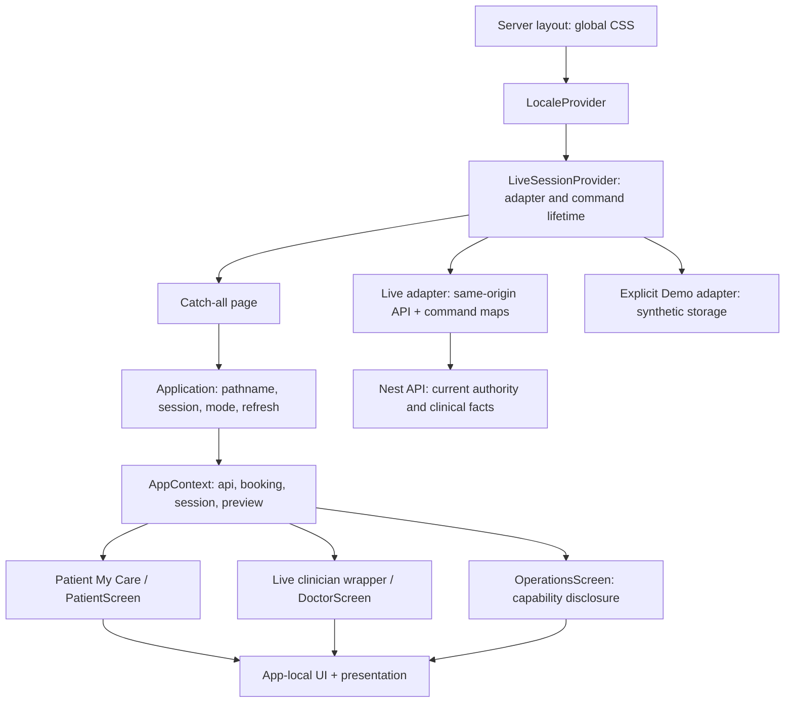

# Frontend Architecture V2 comparative proposal

**Issue #116 · DOCUMENTATION / READ-ONLY · neither architecture selected or implemented.** This is one proposal in three documents: [boundaries/options](CURRENT_BOUNDARIES_AND_AB_OPTIONS.md), [risks, F06 and rollback](RISKS_F06_DEPENDENCIES_AND_ROLLBACK.md), [owner decision and validation](OWNER_DECISION_AND_VALIDATION.md). Controlling [owner decision 6785655141](https://github.com/abuhmaid28/egyhealth360/pull/115#issuecomment-6785655141) accepts audit #115 at `1dda926d0bedfad9fa0ccb69c013aa8263742386` as **INCOMPLETE / CONDITIONAL ONLY**. No demonstrated P0/P1 in executed checks is not evidence of absence in untested environments. Final DS, architecture selection, remediation and implementation require separate decisions.

## 1. Evidence rules and fresh baseline

- **OBSERVED SOURCE**: source inspected for this proposal at freshly fetched main `5355ae5b12bb86ed2c05f70fcadd77eadcd7bde3`, 11 November 2026. Source links below pin that SHA; no drift from issue-preparation main or audit runtime baseline. Branch `docs/116-frontend-v2-proposal` starts directly there, independently of every unmerged reference.
- **EXECUTED HISTORICAL AUDIT**: [#115 baseline/E01–E17](https://github.com/abuhmaid28/egyhealth360/blob/1dda926d0bedfad9fa0ccb69c013aa8263742386/docs/health-audit-2026-11/BASELINE_AND_TEST_MATRIX.md), [findings](https://github.com/abuhmaid28/egyhealth360/blob/1dda926d0bedfad9fa0ccb69c013aa8263742386/docs/health-audit-2026-11/HEALTH_FINDINGS.md), [readiness](https://github.com/abuhmaid28/egyhealth360/blob/1dda926d0bedfad9fa0ccb69c013aa8263742386/docs/health-audit-2026-11/FRONTEND_V2_READINESS.md), [independent review](https://github.com/abuhmaid28/egyhealth360/blob/1dda926d0bedfad9fa0ccb69c013aa8263742386/docs/health-audit-2026-11/INDEPENDENT_REVIEW_AND_HANDOFF.md). These executions were not rerun here.
- **PROPOSED**: future ownership, budgets, tests and migration below; no prototype or measured A/B result. **UNVERIFIED**: exposure/performance/platform/hosted behavior without direct proof. **NEEDS APPROVAL**: owner choices explicitly identified; reading an accepted visual reference does not authorize importing it.

Authority follows [AGENTS](../../../AGENTS.md), [Charter](../../FOUNDATION_CHARTER.md), current issue/owner scope, accepted [UX](../../UX_FOUNDATION.md), [IA](../../IA_SITEMAPS.md), [content](../../CONTENT_SYSTEM.md), [Arabic](../../ARABIC_UX.md), [security](../../SECURITY.md), [I1](../../V3_I1_CONTRACT.md), [I2](../../V3_I2_CONTRACT.md), [I3](../../V3_I3_CONTRACT.md), [Pharmacy implementation](../../V3_I3_SLICE2.md). Main's old status paragraphs and universal-24h prose are historical where later explicit decisions supersede them; this PR adds pointers, not contract amendments.

| Independent source PR | Verified exact head; all Draft/Open/Unmerged | Authority within its scope |
| --- | --- | --- |
| [#101](https://github.com/abuhmaid28/egyhealth360/pull/101) | `687f94074c0ac4d45610546517ea6aa228d36183` | [AP02 decision](https://github.com/abuhmaid28/egyhealth360/pull/101#issuecomment-6761920764): DP01/DP02/AP01/AP02/AP04 accepted; AP03/AP05 OPEN |
| [#103](https://github.com/abuhmaid28/egyhealth360/pull/103) | `4052e2657dd8d354fe11e33ed51fc32ec8065583` | [Blueprint only](https://github.com/abuhmaid28/egyhealth360/pull/103#issuecomment-6763681689), no final tokens |
| [#105](https://github.com/abuhmaid28/egyhealth360/pull/105) | `82fbbe9fef28a6407947852d47473ea35cd057a8` | [Preliminary foundations, scoped CD07, Navigation A review direction](https://github.com/abuhmaid28/egyhealth360/pull/105#issuecomment-6766897207) |
| [#107](https://github.com/abuhmaid28/egyhealth360/pull/107) | `56f4f700aa83297c9f5c164a5304135303137f75` | [Preferred Patient/Doctor visuals](https://github.com/abuhmaid28/egyhealth360/pull/107#issuecomment-6769908758), not complete behavioral contracts |
| [#109](https://github.com/abuhmaid28/egyhealth360/pull/109) | `69a5113d310158b55bdb2000982fd6d2e34f35bd` | [Preferred staff/FUTURE Lab/Admin visuals](https://github.com/abuhmaid28/egyhealth360/pull/109#issuecomment-6779297149), not Live authority |
| [#111](https://github.com/abuhmaid28/egyhealth360/pull/111) | `84e39a14a888686307562a5df383d2a475bfcd2f` | [Consolidation/T1 decision](https://github.com/abuhmaid28/egyhealth360/pull/111#issuecomment-6783144377); [exact reference](https://github.com/abuhmaid28/egyhealth360/blob/84e39a14a888686307562a5df383d2a475bfcd2f/docs/design-system-v2/consolidation-review/CONSOLIDATED_REFERENCE.md) |
| [#113](https://github.com/abuhmaid28/egyhealth360/pull/113) | `9ba6ea54a0ca2facd75bc962b953d62a2df75449` | [Accepted CD07 reconciliation/audit authorization](https://github.com/abuhmaid28/egyhealth360/pull/113#issuecomment-6783681366); [canonical amendment](https://github.com/abuhmaid28/egyhealth360/blob/9ba6ea54a0ca2facd75bc962b953d62a2df75449/docs/ARABIC_UX.md) |
| [#115](https://github.com/abuhmaid28/egyhealth360/pull/115) | `1dda926d0bedfad9fa0ccb69c013aa8263742386` | Incomplete/conditional audit ledger, no merge or architecture decision |

All source heads and their owner comment histories were re-read. Later decisions above control older pending text; none selects A or B. No source branch is modified, merged or cherry-picked.

## 2. Current route, provider, feature and state graph

[layout.tsx](https://github.com/abuhmaid28/egyhealth360/blob/5355ae5b12bb86ed2c05f70fcadd77eadcd7bde3/apps/web/app/layout.tsx) imports global CSS and wraps LocaleProvider → LiveSessionProvider → children. [Optional catch-all page](https://github.com/abuhmaid28/egyhealth360/blob/5355ae5b12bb86ed2c05f70fcadd77eadcd7bde3/apps/web/app/%5B%5B...path%5D%5D/page.tsx) passes build-derived `EH_UI_LIVE_CONFIGURED` to client [Application](https://github.com/abuhmaid28/egyhealth360/blob/5355ae5b12bb86ed2c05f70fcadd77eadcd7bde3/apps/web/src/components/application.tsx). Application eagerly imports PatientScreen, PatientMyCare, DoctorScreen, ClinicianConsultation and OperationsScreen. It resolves mode/adapter/session in an effect, builds booking service, supplies AppContext and dispatches path + role + Live/Demo. These client checks are presentation guards; the backend remains authoritative.

| Present path / route | Observed boundary / dependencies / risk |
| --- | --- |
| `app/[[...path]]/page.tsx`, `loading.tsx`, `error.tsx` | One catch-all, loading and error boundaries; not five isolated frontends. Client components can prerender. Server component default is not proof of server-only imported UI. |
| `components/application.tsx`, `context.tsx`, `portal-shell.tsx` | `/patient`, `/doctor`, `/pharmacy`, `/laboratory`, `/admin`; boot/login, role-home redirect and safe workspace mismatch. My Care special-cases exact `/patient`; Live Doctor special-cases `/doctor/consultation/:bookingId/documentation`. `/patient/appointments/:bookingId` dispatches to LiveBookingDetail; `/doctor/consultation/:bookingId` dispatches to LiveConsultationShell, with the `/documentation` special case retained above. Other paths pass to role dispatcher. Shell owns navigation/mode disclosures, not permissions. |
| `patient-my-care.tsx`, `patient.tsx`, `live-home.tsx`, `live-booking.tsx`, `journey.tsx`, `availability.tsx` | Appointment read/detail, discovery, booking and permitted released-history retrieval. Patient own access; data absence cannot imply clinical completeness. |
| `doctor.tsx`, `clinician-consultation.tsx`, `clinician-consultation-presentation.tsx`, `consultation-opening.tsx`, `live-documentation.tsx`, `documentation.tsx`, `follow-up-intents.tsx`, `consultation-close.tsx` | Current patient/visit/source context; opening, document/release/follow-up/close remain separate commands. Wrapper changes appearance, not source authority. Doctor imports `AppointmentRow`/`Stat` from Patient; Operations imports Patient `Stat`: actual cross-role coupling. |
| `operations.tsx` | Live Pharmacy fulfillment unavailable despite implemented backend; Lab orders/results unavailable/FUTURE; Admin public directory only, management unavailable. Settings path is separate; screenshot buttons confer no capability. |
| `ui.tsx` | Modal/Icon/Badge/Avatar/Card/Field plus localized Logo/Heading/Loading, `useResource`, Resource, SessionRecovery, date/time. Resource knows API error strings; recovery reloads page. This mixed module cannot be lifted wholesale into neutral UI. |
| `lib/api/contracts.ts`, `booking.ts`, `live-booking.ts`, `availability.ts`, `consultation-opening.ts`, `documentation.ts`, `follow-up-intents.ts`, `consultation-close.ts`, `errors.ts` | Transport/domain types, projection and pending/uncertain command identity. Remain app/domain owned under either option. No UI package cache/retry/authorization service. |
| `lib/clinical/documentation.ts`, `lib/presentation.ts`, `patient-my-care*.ts`, `clinician-consultation-copy.ts` | Clinical source/audience semantics, time precision, role copy and view projection; not neutral primitives. |
| `lib/mock/{adapter,fixtures,booking,documentation-controlled}.ts`, `previews/documentation.tsx` | Explicit synthetic Demo/controlled preview inputs; never fallback data for Live failures or runtime clinical evidence. |
| `lib/i18n/{context.tsx,catalog.ts,ar.ts}` | EN initial state; storage-effect AR; literal-key fallback to English (F03/F04). Critical identity/status/action/recovery copy needs separately approved safe Arabic behavior. |

[LiveSessionProvider](https://github.com/abuhmaid28/egyhealth360/blob/5355ae5b12bb86ed2c05f70fcadd77eadcd7bde3/apps/web/src/components/live-session.tsx) retains Live adapter in memory across navigation, not an authorization cache. Browser storage holds mode/locale and separate synthetic Demo data, never Live identity/CSRF/medical cache. [Live adapter](https://github.com/abuhmaid28/egyhealth360/blob/5355ae5b12bb86ed2c05f70fcadd77eadcd7bde3/apps/web/src/lib/api/live.ts) uses `/api/v1`, browser-managed HttpOnly cookie, `credentials:same-origin`, `cache:no-store`, in-memory CSRF, explicit service recovery and sanitized errors. Mutations have manual identical-command/key recovery; no automatic retry. Provider resets/remounts/reload can lose memory-only uncertain command keys; neither extraction nor rollback may promise to reconstruct them from UI state.

Fresh read-only inventory confirms **26 TSX / 23 client directives** and zero imports of `@egyhealth/ui` in app/package source. This is source inventory, not a client-byte percentage. [ui index](https://github.com/abuhmaid28/egyhealth360/blob/5355ae5b12bb86ed2c05f70fcadd77eadcd7bde3/packages/ui/src/index.ts) is `export {};`; [web manifest](https://github.com/abuhmaid28/egyhealth360/blob/5355ae5b12bb86ed2c05f70fcadd77eadcd7bde3/apps/web/package.json) has Next16.4.1, React/ReactDOM19.3.0, no UI workspace dependency. Five roles are not five package consumers. Historical #115 build: **17 static JS chunks, 974090 raw bytes / 284908 summed individual gzip bytes**. These are neither route first-load transfer nor A/B performance deltas; no saving is claimed.

## 3. Equal future ownership proposals

All NEW paths in this table are **prospective**, not current files. Exact filenames are reviewable responsibility boundaries, not authorization to create them. Both retain the existing catch-all/deep links first; route-file decomposition is a later owner-reviewed choice with redirect/context tests, not a prerequisite to either option.

| Present module / responsibility | A — evolve inside `apps/web` | B — neutral extraction into `packages/ui` |
| --- | --- | --- |
| `components/ui.tsx`: neutral Modal/Icon/Card/Field/Badge | NEW `apps/web/src/components/primitives/{modal,icon,card,field,badge}.tsx`; typed DOM props, safe labels supplied by caller, no resource/session import | NEW `packages/ui/src/{modal,icon,card,field,badge}.tsx`; same contract and accessibility bar; prove actual Patient and Doctor usage of the same primitive first |
| `ui.tsx`: Logo, Heading/Empty/Loading localized composition | NEW `apps/web/src/components/presentation/{brand,feedback}.tsx`; app translation and safe content | Same app files; may compose package shapes, pass localized text/direction explicitly; no import of app locale provider into package |
| `ui.tsx`: useResource/Resource/SessionRecovery | NEW `apps/web/src/components/resources/resource.tsx`; retain sanitized errors and recovery behavior | Same app-owned resource wrapper, never in package; neutral status layout receives content only |
| `ui.tsx`: date/time; `lib/presentation.ts`, copy modules | Future app `lib/presentation.ts` scope-specific formatters and app copy ownership; preserve exact source/time contracts | Identical app ownership; no clinical formatter or source status mapping in package |
| `patient-my-care.tsx`, `patient.tsx` | NEW `apps/web/src/features/patient/` read/detail presentations; existing API projections/provider remain initially | Same feature boundary; imports only genuinely shared neutral package pieces |
| `doctor.tsx`, clinician/documentation/follow-up/close group | NEW `apps/web/src/features/consultation/` presentations; private/source/command coordinators stay app-owned; remove cross-role imports only in later approved slices | Same; no editor command state, clinical workflow, permissions or signed/released model in package |
| `operations.tsx` | Later NEW `features/{pharmacy,admin,laboratory}/` only after capability-specific authorization; Lab remains FUTURE | Same; package shared chrome cannot unlock a capability |
| `application.tsx`, `context.tsx`, `live-session.tsx`, `lib/api/*`, `lib/mock/*` | Retain mode/session/domain adapter lifetime; later NEW `components/workspace-dispatch.tsx` only with behavioral equivalence evidence | Identical app ownership, no package imports of adapters, contexts, mock fixtures, routes, session, operation keys or runtime commands |
| Global/scoped CSS and fonts | NEW `apps/web/src/styles/v2-tokens.css` scoped bridge and primitive CSS modules; V1 callers preserved until approved replacement | NEW `packages/ui/src/tokens.css` / primitive CSS for approved neutral roles, one app-level explicit import; fonts/logos loaded once by app, not emitted per component |
| `packages/ui/src/index.ts` | Remains unused until separately justified; no token stub pretending to be reuse | Explicit neutral exports/subpaths; no barrel exporting clinical or eager client-only dependencies |
| Catch-all / route dispatch | Preserve canonical paths, Back/history/query/hash and current patient/visit context; investigate lazy role imports later with evidence | Identical route ownership; importing a package does not split eager Application role imports |

For A, enforce a one-way graph: app feature → neutral primitive; primitive must not import app features/API/session/locale/clinical modules. For B, enforce the same fence plus **no package→app import**, no secret/server DB/config imports and no private data in examples, build output, logs or static assets. Pure/server-compatible leaves and interactive client leaves must be separable in both; placing `use client` on a root barrel is not an SSR strategy. Type-only versus runtime cycles must be reported separately (adjacency appendix below); breaking cycles is a future scoped task, not evidence already fixed.

### Toolchain, dependencies and failure modes

[Root toolchain](https://github.com/abuhmaid28/egyhealth360/blob/5355ae5b12bb86ed2c05f70fcadd77eadcd7bde3/package.json): Node24.21.0, pnpm10.34.6, TypeScript5.9.3; pnpm workspaces, Nest modular monolith, PostgreSQL18/Prisma7, REST/OpenAPI, Docker and Actions retained. A uses existing Next JSX/DOM/Bundler config and CSS processing; no new library is demonstrated necessary. Its risk is app-local conventions eroding, duplicated widgets and global CSS leaking across roles. A must pass the same import-fence, typed DOM, a11y and budget gates as B.

B's current [tsconfig](https://github.com/abuhmaid28/egyhealth360/blob/5355ae5b12bb86ed2c05f70fcadd77eadcd7bde3/packages/ui/tsconfig.json) includes only `src/**/*.ts`, extends ES2023/NodeNext, and defines no JSX/DOM contract. Its manifest currently exports `dist/index.js` and declarations with `tsc` build. Future work must separately justify JSX/DOM/types, React peer/singleton policy, emitted ESM extension/declaration correctness, preserved client directives, server-safe subpaths, consumer build order, CSS export/import order and side-effect retention. Test built exports in Next, not only source imports. A future web→UI workspace edge must be declared before relying on pnpm topological order. Publishing/versioning/registry/CDN is unnecessary for one private workspace; no external package service or paid infrastructure is proposed. Failure modes include stripped client markers, duplicate React/hook failure, missing CSS after tree shaking, overbroad client barrels, duplicated fonts and artificial abstractions with one consumer.

Neither option fixes F01 advisories, F06 routing, F03/F04 locale, missing capabilities or clinical policy by moving files. Any new dependency needs necessity, existing-alternative, maintenance/license/security and transitive exposure analysis before owner authorization. No dependency/lockfile/config changes occur here.

## 4. Styling, assets, locale and owner-gated design

Current [global CSS](https://github.com/abuhmaid28/egyhealth360/blob/5355ae5b12bb86ed2c05f70fcadd77eadcd7bde3/apps/web/app/globals.css) declares Inter/Noto, light navy/teal variables and global element/control selectors. [My Care scoped CSS](https://github.com/abuhmaid28/egyhealth360/blob/5355ae5b12bb86ed2c05f70fcadd77eadcd7bde3/apps/web/src/components/patient-my-care.module.css) adds Manrope/Plex, different care tokens and local fonts; clinician and portal CSS alias/use those tokens and global classes. V1 light-only `color-scheme`, old logo/tagline and local font-family collisions are observed inventory, not accepted V2. Both options need scoped token bridge, explicit CSS order and per-screen computed-style/font checks; package ownership cannot solve cascade collisions automatically.

Accepted Brand raw roles are pinned [96 audited records](https://github.com/abuhmaid28/egyhealth360/blob/687f94074c0ac4d45610546517ea6aa228d36183/docs/brand-source-exact-100/ap01-ap04-review/evidence/color-pairs.json), blob `53300351b7e860b29d4c806d73088bead2acc8d6`. Exact Light canvas/base/raised `#F8F7FB/#FFFFFF/#EFEAF7`, text `#17142B/#595269`, action fill/ink `#6240B8/#FFFFFF`, hover `#50309D`, control border `#787084`; Dark `#10121D/#1D2030/#262A3C`, text `#F6F2FF/#C2BED2`, action `#A78BFA/#17142B`, hover `#BDA7FF`, control border `#85839C`. Apricot `#FFB88B` is nonsemantic. Raw pair approval is not arbitrary cross-product contrast approval or clinical status mapping.

**NEEDS APPROVAL in BOTH options:** aliases `surface.canvas/base/raised`, `text.primary/secondary`, `action.primary`, `focus.ring`, feedback/selection/link/skeleton roles; clinical/status labels and semantics remain contract-derived. #105 proposed spacing4/8/12/16/24/32/48, control8/card12/context16px; preferred pilots use control10–12/cards/dialog18–24. Focus ring3px has proposed3px gap versus preferred4px. Icons: 24px grid/1.75px stroke, proposed20px inline versus22px #107/21px #109. Type scale EN30/20/16 and AR real400/600, critical-text floor, elevation/density, width cap1600 versus1328, breakpoints/sticky shell and staff/Admin navigation are unresolved normalization choices. Patient/Doctor Navigation A is preferred review direction, not final five-portal layout. No radius, token API or package ownership is frozen here.

**T1 accepted direction, unimplemented:** System default + in-memory current-session System/Light/Dark override, survives in-app navigation; clears on logout/account switch/session end/fresh session/reload. No localStorage/cookie/account synchronization for theme. Both need an approved initial-paint/hydration policy that honors these resets, system changes, forced colors and denied storage without leaking identity; do not reuse persisted locale/mode as theme policy. Current EN `html` and locale effect ordering remain F04; no visible-flash or hydration-error claim follows solely from source. Validate initial HTML and pre/post-hydration computed theme/locale separately, with slow JS and disabled JS, AR reload and font failure. No blanket client-only wrapper or hydration-warning suppression is accepted as proof.

**CD07:** future V2 Patient appointment **overview and detail only** use localized12h with explicit period. Professional/signature/release/history/audit/validity and consequential precision remain24h. Preserve exact instants, named Gregorian dates, Latin digits, actual IANA event zone/date-specific offsets, repeated-hour both offsets, cross-midnight both dates, overview offset when ambiguous/cross-zone and contract-required seconds/subseconds. Never parse display strings or change half-open server eligibility. Main runtime formatting is unchanged; #113's pinned canonical reconciliation controls future scope, not a blanket all-patient12h preference.

### Prospective asset allowlist, not an import authorization

Source-exact no-tagline AR/EN/bilingual primary shape, DP01 positioning, AP02 gradients and AP04 palette remain immutable. App owns actual font/logo URLs in both options. The following **reference-only** allowlist is generated from exact source Git blobs; no assets are copied. Fonts require the full OFL notices alongside future allowed binaries. Artwork rights remain AP05 OPEN; hashes prove identity, not clearance. Noto is comparison/history, Manrope V1 inventory, neither silently replaces accepted Inter/Plex. Bilingual/compact/PWA variants require their own later exact-file allowlist and AP03 checks before use; this bounded Patient/Doctor candidate lists four primary lockups only.

| Exact source at #101 pinned head | Git blob | SHA-256 | Rights/use limit |
| --- | --- | --- | --- |
| [assets/primary-ar-light.svg](https://github.com/abuhmaid28/egyhealth360/blob/687f94074c0ac4d45610546517ea6aa228d36183/docs/brand-source-exact-100/assets/primary-ar-light.svg) | `30e2f66388345f0863d29dd050429a6e826051a4` | `76d14637666b2d9aadbdc211223454c3f216bff38927c11577ed4d77abce4fa4` | AP05 OPEN; no-tagline source geometry only |
| [assets/primary-ar-dark.svg](https://github.com/abuhmaid28/egyhealth360/blob/687f94074c0ac4d45610546517ea6aa228d36183/docs/brand-source-exact-100/assets/primary-ar-dark.svg) | `4581e121783a9fc8db772908271e5cafd926fd04` | `f96e38a2a6e1e7273edd57b8e98005f28b0894efa03ffba41ef2c0394a5196da` | AP05 OPEN; no-tagline source geometry only |
| [assets/primary-en-light.svg](https://github.com/abuhmaid28/egyhealth360/blob/687f94074c0ac4d45610546517ea6aa228d36183/docs/brand-source-exact-100/assets/primary-en-light.svg) | `d07d0662f2bdd32f9ad68032726208b51fa00ab8` | `f6935c1441d2e68092109425d31f707621f6ec33b405d6ceb00fc0876f53b54e` | AP05 OPEN; no-tagline source geometry only |
| [assets/primary-en-dark.svg](https://github.com/abuhmaid28/egyhealth360/blob/687f94074c0ac4d45610546517ea6aa228d36183/docs/brand-source-exact-100/assets/primary-en-dark.svg) | `f209d89484e1c0656ee2e020170b36bf7b41cfe7` | `eaa33073140aff82d87d34e134157671f7f8d38ac625618a26b69978641bddd5` | AP05 OPEN; no-tagline source geometry only |
| [ap01-ap04-review/fonts/inter-variable.ttf](https://github.com/abuhmaid28/egyhealth360/blob/687f94074c0ac4d45610546517ea6aa228d36183/docs/brand-source-exact-100/ap01-ap04-review/fonts/inter-variable.ttf) | `047c92f6e2212473dc436020afed689527076d44` | `29160a80ff49ddcab2c97711247e08b1fab27a484a329ce8b813d820dc559031` | Full OFL; preserve notices and genuine weights |
| [ap01-ap04-review/fonts/plex-400.ttf](https://github.com/abuhmaid28/egyhealth360/blob/687f94074c0ac4d45610546517ea6aa228d36183/docs/brand-source-exact-100/ap01-ap04-review/fonts/plex-400.ttf) | `e779068718b9801b809605b2bf3067121cce524c` | `6f611412270a132bbac838da9259d4c68569b4175f3b3b8fa3fa36a30b56dab9` | Full OFL; preserve notices and genuine weights |
| [ap01-ap04-review/fonts/plex-600.ttf](https://github.com/abuhmaid28/egyhealth360/blob/687f94074c0ac4d45610546517ea6aa228d36183/docs/brand-source-exact-100/ap01-ap04-review/fonts/plex-600.ttf) | `f7a7fc87747a9ddabb3557d4a3f4140a7a1460b0` | `597bd5502e5997be4414e4c9c88834b30ff3784250c84f20bce2b20e53ebd467` | Full OFL; preserve notices and genuine weights |
| [ap01-ap04-review/fonts/inter-OFL.txt](https://github.com/abuhmaid28/egyhealth360/blob/687f94074c0ac4d45610546517ea6aa228d36183/docs/brand-source-exact-100/ap01-ap04-review/fonts/inter-OFL.txt) | `909a6bf9cfb4849d4468a723cc16ffb7a183bd09` | `5dd548d31a85f756e01d63e00d7faf1e324103ed3e9102fcbbabf2cc2db6dd39` | Full OFL; preserve notices and genuine weights |
| [ap01-ap04-review/fonts/ibmplexsansarabic-OFL.txt](https://github.com/abuhmaid28/egyhealth360/blob/687f94074c0ac4d45610546517ea6aa228d36183/docs/brand-source-exact-100/ap01-ap04-review/fonts/ibmplexsansarabic-OFL.txt) | `670c6c04ec17a19131aefbb47472a11c2a5d831c` | `d741e57d5f865e294df801f96b7b5161a88b211df65887e4358d271c9fc5fb4f` | Full OFL; preserve notices and genuine weights |

No external release, native icon/manifest/service worker or offline clinical caching work is authorized. AP03 still requires actual browser/device/PWA/OS text/native400%/AT/physical print coverage, including the five Type3 PDF warnings. AP05 still requires creator/derivative permission, originality/exclusivity and trademark review before applicable distribution; font OFL is not logo permission.

## 5. Fair comparison and common measurable bar

Ordinal assessment: **+** evidence favors lower current risk; **−** extra burden; **?** unproved. This is an evidence matrix, not weighted precision or a selection. No runtime A/B experiment is authorized.

| Same criterion / evidence | A | B | What would resolve the uncertainty |
| --- | --- | --- | --- |
| Current real consumers, provider and routes | + existing app composition | − zero package consumers; new edge/toolchain | Same neutral Field/Card used in Patient and Doctor without domain props; no claim of a second app |
| Separation and maintainability | ? import fences can erode; local duplication risk | ? exports can enforce boundary; abstraction/version coupling risk | Same import-fence report, API surface and cycle inventory; independent review |
| SSR/client, locale/T1 first paint | ? current coupling/EN-first needs evidence | ? package may widen client graph | Same cold SSR/hydration traces and route transfer measurements, no warnings |
| Performance/build/free usage | ? no migration measurement | ? build/exports/CSS overhead; no saving measured | Same runner/toolchain/lockfile, three comparable builds and median; route-specific network HAR |
| Clinical/privacy/session/navigation | ? same mandatory negative tests | ? same mandatory negatives plus package fence | Identical authorized fixtures and retained command/provider lifetime |
| Accessibility and assets | ? same unresolved platform/copy gates | ? same plus per-export semantic contract | Same AT/keyboard/RTL/theme matrix, asset hashes/OFL and rights holds |
| Rollback | + app-only slice revert possible, not rehearsed | − must atomically revert export/consumer/CSS/toolchain edge | Same uncertain-command safeguard and exact UI-only commit rehearsal |
| Genuine future multi-app reuse | − no independent reuse boundary yet | + only if another actual consumer later demonstrates need | Named consumer/requirements and changed-API cost; five portals alone insufficient |

**Common proposed budgets, subject to owner ratification before implementation:** zero new paid services; zero unauthorized domain imports/private payload in neutral primitives; zero new dependencies absent explicit justification; zero hydration errors; zero duplicate approved font downloads per navigation; zero critical identity/status/action loss at320px,200% text and native400% zoom. Capture baseline for the same Patient and Doctor routes first. Proposed guardrail: no increase in route-specific compressed JS over that same measured baseline, and investigate median build duration >10% above three matching baseline runs; any exception needs measured cause and owner disposition. These are acceptance proposals, not established performance wins or current first-load numbers. Record chunks/raw/gzip consistently but do not use all-static totals as the route budget.

Same minimum future matrix: Patient `/patient` and appointment detail; Doctor existing consultation documentation route, **read-only authorized inspection** of patient/visit/source context. Cover ready/loading/empty/error/denied/expired/uncertain/released versus private states, EN/AR × LTR/RTL × intentional Light/Dark ×1440/834/390 plus320 reflow; keyboard-only navigation, dialog Escape/containment/return, labelled landmarks/current location, long names and focus after Back. Deep-link/reload/history/hash/query and unsaved draft context must survive as approved; navigating never invokes sign/release/close. Real AT/physical/PWA checks remain separate AP03 evidence, not replaced by axe. Historical E15:8 scenes0 detected violations,7 contrast-incomplete; no WCAG certification.

Future A and B both require frontend build/typecheck/lint/unit/browser, approved clinical negative regressions, exact-head applicable CI and independently reviewed reversible UI-only boundaries. B additionally proves built package exports/types/CSS/client markers and singleton React; A additionally proves local primitive import fences without package enforcement. [Risks and phased gates](RISKS_F06_DEPENDENCIES_AND_ROLLBACK.md) apply equally. **Bounded recommendation:** evaluate app-local boundaries first because current consumers are app-local; preserve B as a real alternative if consumer evidence justifies its added toolchain. This recommendation neither selects A nor authorizes evidence-gathering code.

## 6. Exact current import adjacency and source blobs

The inventory below is freshly generated read-only from TypeScript import declarations at main. Paths are relative to `apps/web/`; `T:` marks an entirely type-only import, `M:` a mixed import with type and runtime bindings. Extensionless targets retain source spellings; CSS imports are included. Runtime reachability additionally follows client boundaries and bundler behavior; this is a source graph, not a measured bundle graph. The package has zero consumers and no outgoing imports. Blob IDs pin inspected source; future modules from section3 are absent.

Fresh AST strongly connected component analysis, resolving relative TS/TSX imports: the runtime graph has one cycle, `components/live-booking.tsx` ↔ `components/consultation-opening.tsx`. Including type-only edges adds a five-module component: `lib/api/consultation-opening.ts`, `contracts.ts`, `documentation.ts`, `follow-up-intents.ts`, `live-booking.ts`. That type-inclusive cycle is not an additional runtime cycle. These are coupling observations, not demonstrated initialization failures; neither option gets credit for breaking them without later evidence.

| Current source | Git blob | Boundary | Direct imports (types distinguished) |
| --- | --- | --- | --- |
| `app/[[...path]]/page.tsx` | `6e0ff0a1b3afa9ff83506fbc552aae144526c1b4` | default / library | `../../src/components/application` |
| `app/error.tsx` | `80a650bfdcaa1e25e0eebb2ffbef3194dd87ba96` | client directive | `../src/components/patient-my-care.module.css`, `../src/components/portal-shell.module.css`, `../src/lib/i18n/context` |
| `app/globals.css` | `7bf1a5589da4dcc5c4ac136fca08a104ffe01a6e` | CSS | none |
| `app/layout.tsx` | `1afce9fbb713fa2637a8afa2e613385a1b9fcea0` | default / library | `T:react`, `./globals.css`, `../src/components/live-session`, `../src/lib/i18n/context` |
| `app/loading.tsx` | `162166ba71d1c6c8182b334d52ba1daf2164d568` | default / library | `../src/components/ui` |
| `next.config.ts` | `94a5b18e810bb37d3fc804ba78bf18872c23a5d3` | default / library | `T:next` |
| `src/components/application.tsx` | `924bbb8bdcc5b15f84f68f1602374ea5483dc09a` | client directive | `../lib/api/errors`, `../lib/i18n/context`, `next/link`, `next/navigation`, `react`, `T:../lib/api/contracts`, `../lib/mock/adapter`, `./live-session`, `../lib/api/booking`, `./context`, `M:./ui`, `./portal-shell`, `./patient-my-care.module.css`, `./portal-shell.module.css`, `./patient`, `./patient-my-care`, `./clinician-consultation`, `./doctor`, `./operations` |
| `src/components/availability.tsx` | `b1cf83b943acbdc3d529eaa0bb04135f2f37798b` | client directive | `../lib/presentation`, `../lib/api/errors`, `../lib/i18n/context`, `react`, `T:../lib/api/contracts`, `./context`, `./ui` |
| `src/components/clinician-consultation-presentation.tsx` | `c9840daf92972f436220d5933e8e61f233728ee1` | client directive | `next/link`, `react`, `../lib/i18n/context`, `../lib/clinician-consultation-copy`, `../lib/presentation`, `../lib/patient-my-care`, `T:../lib/clinical/documentation`, `./ui` |
| `src/components/clinician-consultation.module.css` | `e885ce1662051453d3beb2416e0a44594768f8d9` | CSS | none |
| `src/components/clinician-consultation.tsx` | `6a573133c27be04aa09c755c0e9adad9f7be0e4f` | client directive | `../lib/i18n/context`, `../lib/clinician-consultation-copy`, `./ui`, `./live-documentation`, `./clinician-consultation-presentation`, `./portal-shell`, `./patient-my-care.module.css`, `./clinician-consultation.module.css` |
| `src/components/consultation-close.tsx` | `91cc0ae5b17b41ba7867fc561ec27edeb08b2b20` | client directive | `next/link`, `../lib/presentation`, `./clinician-consultation-presentation`, `react`, `M:../lib/api/consultation-close`, `T:../lib/api/documentation`, `../lib/clinical/documentation`, `../lib/api/follow-up-intents`, `../lib/api/errors`, `../lib/i18n/context`, `./context`, `./ui` |
| `src/components/consultation-opening.tsx` | `77486112ef4fa2576e9d57cb73c0e31856fa130e` | client directive | `next/link`, `react`, `T:../lib/api/consultation-close`, `T:../lib/api/live-booking`, `M:../lib/api/consultation-opening`, `../lib/api/errors`, `../lib/presentation`, `../lib/i18n/context`, `./context`, `./live-booking`, `./ui` |
| `src/components/context.tsx` | `2d040a0a4ac39c0edcb0df63ddaabc15f0228933` | client directive | `react`, `T:../lib/api/contracts`, `T:./ui`, `T:../lib/api/booking`, `T:../lib/api/contracts` |
| `src/components/doctor.tsx` | `80775e0f31cf092c068e7d941eb7e4cdfcd62ad4` | client directive | `./live-documentation`, `../lib/presentation`, `../lib/api/errors`, `../lib/i18n/context`, `next/link`, `react`, `T:../lib/api/contracts`, `./context`, `./live-booking`, `./consultation-opening`, `./journey`, `./availability`, `./patient`, `./ui` |
| `src/components/documentation.tsx` | `48b28c436e4ec6ed51203ef429b9f33b57e95a43` | client directive | `../lib/presentation`, `../lib/patient-my-care`, `./clinician-consultation-presentation`, `react`, `../lib/i18n/context`, `../lib/api/errors`, `M:../lib/clinical/documentation`, `./ui` |
| `src/components/follow-up-intents.tsx` | `e26f1b6a8009bebb634606d5fe836bfe6f509513` | client directive | `next/link`, `react`, `./clinician-consultation-presentation`, `../lib/patient-my-care`, `./context`, `../lib/i18n/context`, `../lib/presentation`, `../lib/api/errors`, `M:../lib/api/follow-up-intents`, `./ui` |
| `src/components/journey.tsx` | `f55af3312e8338879bbc76621feb7fc5caeff889` | client directive | `react`, `next/link`, `T:../lib/api/contracts`, `../lib/i18n/context`, `./context`, `./ui` |
| `src/components/live-booking.tsx` | `8c0508c0ca91b8d82ffafd2b62bcaf58b2c91d9d` | client directive | `next/link`, `../lib/presentation`, `./consultation-opening`, `next/navigation`, `react`, `T:../lib/api/contracts`, `M:../lib/api/live-booking`, `../lib/api/errors`, `../lib/i18n/context`, `./context`, `./ui` |
| `src/components/live-documentation.tsx` | `8bf2dc8af97abbcfa0b2387b6aac30317f5e8ccc` | client directive | `./consultation-close`, `./clinician-consultation-presentation`, `T:../lib/api/consultation-close`, `./follow-up-intents`, `next/link`, `../lib/presentation`, `react`, `./context`, `../lib/i18n/context`, `../lib/clinical/documentation`, `./documentation`, `./ui` |
| `src/components/live-home.tsx` | `95c379e943601e3a3a92dd84d695dc76075179c8` | client directive | `next/link`, `./context`, `../lib/i18n/context`, `../lib/presentation`, `./live-booking`, `./journey`, `./ui` |
| `src/components/live-session.tsx` | `cecf557550a250f88a60db09320d1d7a368145ca` | client directive | `M:react`, `T:../lib/api/contracts`, `../lib/api/live`, `../lib/mock/adapter` |
| `src/components/operations.tsx` | `dae83cd8e052557efec754189d3096abb4aab7b5` | client directive | `../lib/presentation`, `../lib/api/errors`, `../lib/i18n/context`, `next/link`, `react`, `T:../lib/api/contracts`, `./context`, `./journey`, `./patient`, `./ui` |
| `src/components/patient-my-care.module.css` | `6ed4c7e8f67d6a8c7675acf9b8128caa883d2d42` | CSS | none |
| `src/components/patient-my-care.tsx` | `e4bdc6f7a4048f3b3c12f7d089b630fdd5c3acef` | client directive | `next/link`, `M:react`, `T:../lib/api/contracts`, `T:../lib/api/live-booking`, `../lib/presentation`, `M:../lib/patient-my-care`, `M:../lib/patient-my-care-copy`, `../lib/patient-my-care-avatar`, `../lib/i18n/context`, `./context`, `./live-booking`, `M:./ui`, `./patient-my-care.module.css`, `./portal-shell` |
| `src/components/patient.tsx` | `6e4c7fd546372cbdf6903eb0b341bfdc2cdd6ad3` | client directive | `../lib/presentation`, `./live-home`, `./follow-up-intents`, `./documentation`, `../lib/clinical/documentation`, `../lib/api/errors`, `../lib/i18n/context`, `next/link`, `next/navigation`, `react`, `T:../lib/api/contracts`, `./context`, `./live-booking`, `./journey`, `./availability`, `./ui` |
| `src/components/portal-shell.module.css` | `735fa0d1974faefd623fd4e2bb382edbdb554137` | CSS | none |
| `src/components/portal-shell.tsx` | `c1bf1bc4c60d903ca34420af5ceb688a59dbe177` | client directive | `next/link`, `next/navigation`, `T:react`, `T:../lib/mock/adapter`, `T:../lib/api/contracts`, `../lib/presentation`, `../lib/patient-my-care-copy`, `../lib/i18n/context`, `./context`, `M:./ui`, `./patient-my-care.module.css`, `./portal-shell.module.css` |
| `src/components/ui.tsx` | `a6d78dc2275339da44733fd2ef53b3c1b001e5ca` | client directive | `../lib/api/errors`, `../lib/i18n/context`, `next/link`, `M:react` |
| `src/lib/api/availability.ts` | `e164b6a5c200574b53c7681eb50dea7909a157a2` | default / library | `./errors`, `T:./contracts` |
| `src/lib/api/booking.ts` | `7879d14c48527fd11a8ae47f3b335f8e1444bac4` | default / library | `./errors`, `T:./contracts` |
| `src/lib/api/consultation-close.ts` | `c026a38af059bb16d07e6212cb588009631e271b` | default / library | `./errors` |
| `src/lib/api/consultation-opening.ts` | `0d878eb6e78eccab9bd61be320e485e97fd8093b` | default / library | `./errors`, `T:./live-booking` |
| `src/lib/api/contracts.ts` | `8a7b4efb59f38da37bcb38d8a912edf225867e89` | default / library | `T:./consultation-close`, `T:./follow-up-intents`, `T:./documentation`, `T:../clinical/documentation`, `T:./consultation-opening`, `T:./live-booking` |
| `src/lib/api/documentation.ts` | `043aabb9e9c6c24c9e06bb3598ed1da73db78149` | default / library | `M:../clinical/documentation`, `T:./consultation-opening` |
| `src/lib/api/errors.ts` | `b8c9a52373f96def9ef1600f7daed25af6966cf5` | default / library | none |
| `src/lib/api/follow-up-intents.ts` | `df59b2087dd334883fabe47fdabdd2c9c0ad8c36` | default / library | `./errors`, `../clinical/documentation`, `T:./documentation`, `T:./live-booking`, `T:./contracts` |
| `src/lib/api/live-booking.ts` | `43e925a37eff765d357431b04ba41fea4af74352` | default / library | `./errors`, `T:./contracts` |
| `src/lib/api/live.ts` | `d0ee3bd465c1d3a08ed4b5820c7bdb4dbe1929ac` | default / library | `./consultation-close`, `./follow-up-intents`, `./documentation`, `./consultation-opening`, `./live-booking`, `./errors`, `./availability`, `T:./contracts` |
| `src/lib/clinical/documentation.ts` | `7510ce7c635bf8672a819d1e554eda52857fd374` | default / library | `../api/errors` |
| `src/lib/clinician-consultation-copy.ts` | `b28204bcb353df4e6e656112b6a6920f0902d69a` | default / library | none |
| `src/lib/i18n/ar.ts` | `bbc4f84b4b0fd0cb05aeaa2a21a3a7b8823583d5` | default / library | none |
| `src/lib/i18n/catalog.ts` | `34ec445428ad1e3a8af465752e96a5f6b43b7c45` | default / library | `./ar` |
| `src/lib/i18n/context.tsx` | `1afe8ec1d907fe4ee3c15a045c2c7f71692c7054` | client directive | `M:react`, `M:./catalog` |
| `src/lib/mock/adapter.ts` | `9318dc139d073e85bf5871f2c7355d381e22fb55` | default / library | `../api/errors`, `T:../api/contracts`, `../api/availability`, `./fixtures` |
| `src/lib/mock/booking.ts` | `2cebb1169751c6c0fe87c915f41880a234431fe1` | default / library | `T:../api/contracts`, `T:./adapter` |
| `src/lib/mock/documentation-controlled.ts` | `9dd471d1d2051f094ecc95102d189c71f583293d` | default / library | `M:../clinical/documentation` |
| `src/lib/mock/fixtures.ts` | `4db0f42ecf44efe10f67d3e69a3d123358de483b` | default / library | `T:../api/contracts` |
| `src/lib/patient-my-care-avatar.ts` | `96f9791801ab10ecc5a2e052484f600252302127` | default / library | none |
| `src/lib/patient-my-care-copy.ts` | `b75842a680b6f4d6404fdbdcce96104a975e9d93` | default / library | none |
| `src/lib/patient-my-care.ts` | `abcb1fa696cf15da823f850ac5e0de28cd6f0110` | default / library | `T:./api/contracts`, `T:./api/live-booking`, `T:./clinical/documentation` |
| `src/lib/presentation.ts` | `911c528c7df7bddbb34e5bb2b108cf6454dfa1c6` | default / library | `T:./api/contracts` |
| `src/previews/documentation.tsx` | `e6f183cb8477917365c497149d9a802734dab8b3` | client directive | `react`, `M:../lib/mock/documentation-controlled`, `../components/documentation`, `../components/ui`, `../lib/i18n/context` |
| `packages/ui/src/index.ts` | `cb0ff5c3b541f646105198ee23ac0fc3d805023e` | default / library | none |
