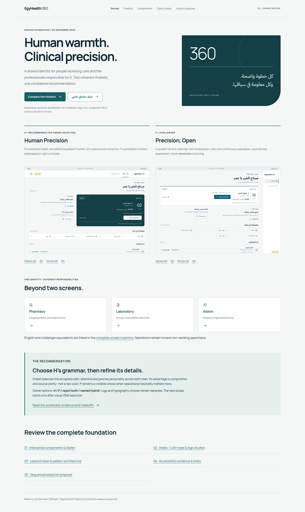

# Human Precision — visual selection package

**Unselected proposal v0.1 · 6 November 2026 · Issue #72.** This sprint delivers visual finalists and a proposed system foundation, not Final Brand V2, a final logo, a versioned production Design System or approved product prototypes.

Open [the visual review](index.html), then [the equal-content finalist comparison](compare.html). The static gallery runs directly from a checkout; local JavaScript enables specimen dialogs, field validation, density and state selection. No app, login, API, storage or paid tool is needed. GitHub renders PNGs, not interactive HTML; download the checkout to navigate the gallery.



## Recommended review sequence

1. Compare **H — Human Precision** and **P — Precision, Open** at identical desktop and mobile sizes. Open each full responsive screen; the comparison board shows thumbnails.
2. Inspect [Arabic components and states](specimen-ar.html), [English equivalents](specimen-en.html), [Arabic/Latin type and mark studies](typography.html), and the [system proposal](system.html).
3. Read the [rationale and comparative scorecard](RATIONALE.md), [token/taxonomy/healthcare patterns](SYSTEM_FOUNDATION.md), [accessibility evidence and limits](ACCESSIBILITY.md), then [sequenced implementation proposal](IMPLEMENTATION_PLAN.md).
4. Record **H / P / reject both / named hybrid**. Record logo and typography refinement separately. No selection is inferred from the recommendation or CI.

**Recommendation: H.** Retain E’s authored bilingual warmth, apply D’s disciplined source hierarchy, and take F’s continuity of context onto light surfaces. P challenges this with a rail, a calendar-led light appointment and continuous information plane; it is a real compositional alternative.

## Coverage and reproduction

Twenty responsive product specimens: two finalists × five roles × Arabic/English. Two interactive component galleries, one bilingual typography/logo study, one system board, a navigable review and an equal-content comparison. Patient and Clinician have desktop, tablet, 390px, 320px and 200% text evidence. Pharmacy, future Laboratory and Admin are deliberately unconnected presentation specimens. All use synthetic data; the Patient/Clinician story is dated **2 November 2026**, preserving the existing D/E/F fixture rather than pretending it is today's Live data.

```sh
python docs/human-precision/tokens.py
python docs/human-precision/generate.py
node docs/human-precision/verify.mjs
python docs/human-precision/check.py
```

Browser verification uses the repository's existing Playwright and `/usr/bin/chromium`. No new dependency or runtime route. Fonts and two SVG studies reference existing licensed assets at their original paths. [Inventory](evidence/inventory.json), [browser measurements/screenshots/contrast](evidence/browser-results.json), [synthetic fixture](evidence/synthetic-fixture.json).

Verified starting main: `5355ae5b12bb86ed2c05f70fcadd77eadcd7bde3`. GitHub #79, #80, #84 and #85 are merged; their original handoff documents retain historical open-PR wording. The direct current user brief authorizes this isolated synthesis exploration and supersedes earlier exploration restrictions within this scope. It does not authorize replacing the merged visual baseline, a final choice, merge, deployment, alias changes or a new capability.

Runtime, schema, API, clinical/security contracts, CI, dependencies, deployment configuration and all historical evidence are preserved. Independent Product Owner visual review, native Egyptian editorial review, assistive-technology testing and real clinical task research remain outstanding. Technical verification is not clinical, usability or design acceptance.
