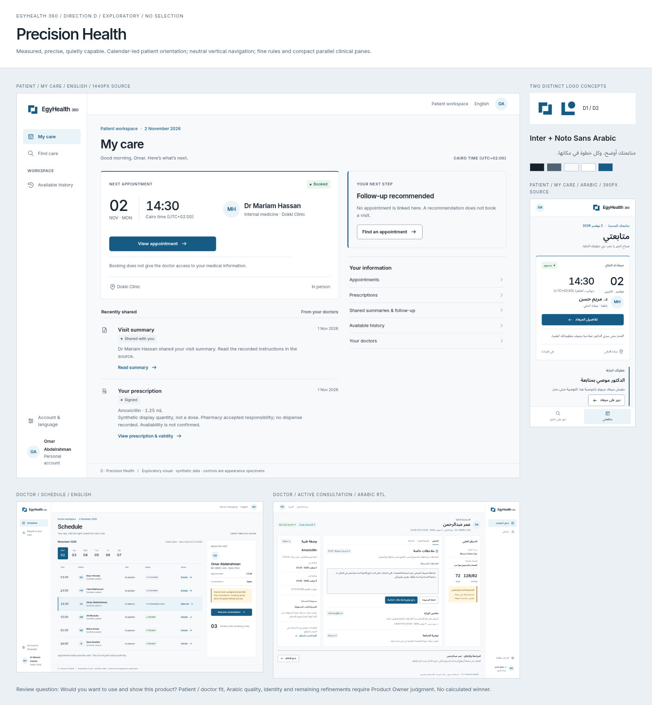
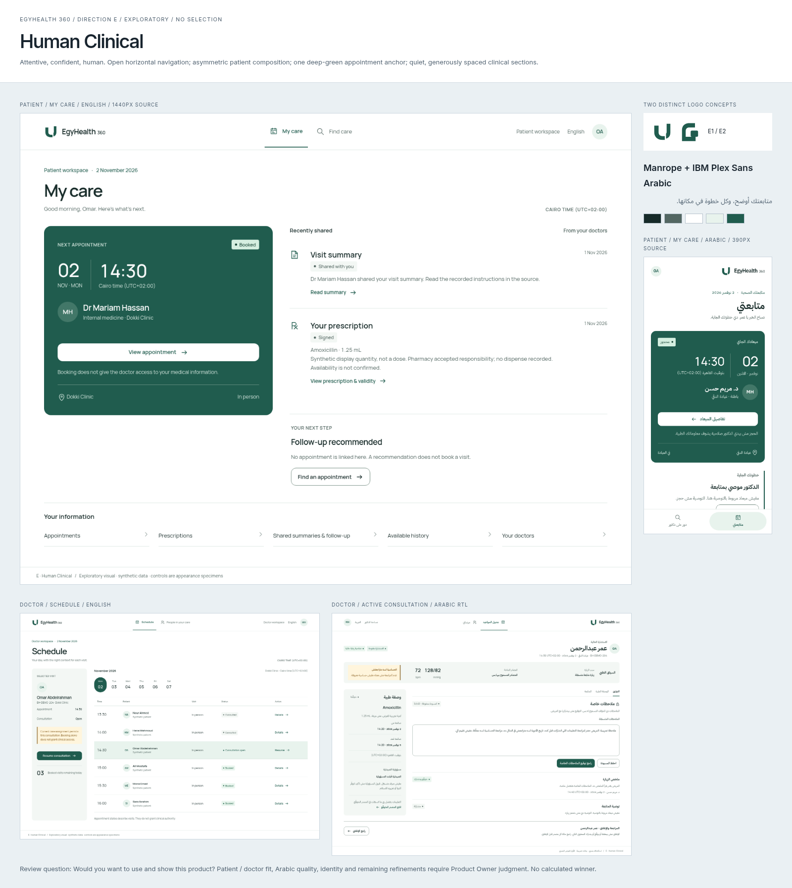
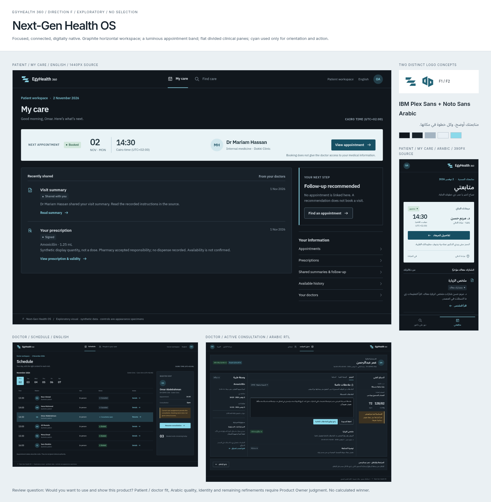

# Visual Directions V2 — D / E / F

**READY FOR PRODUCT OWNER VISUAL DIRECTIONS V2 REVIEW** is the delivery target; actual technical checks and remote CI are recorded in [validation](VALIDATION.md) and the PR handoff. This is an exploratory visual package, not approved final brand, Design System or production UI.

The [explicit owner request](evidence/owner-request.txt) (text preserved, line endings normalized), received 2 November 2026, rejects PR #79 A/B/C as current final-direction candidates. It preserves accepted UX, IA01–IA05, CD01–CD07 and BR01–BR08. The [earlier GitHub authorization](https://github.com/abuhmaid28/egyhealth360/issues/72#issuecomment-6568574368) still governs preserved scope and later gates. No existing logo is selected; B1/C1 are conceptual seeds only. These six new marks were drawn from new vector constructions.

Open [index.html](index.html) from a checkout in a browser. No app, build, backend, sign-in or network is needed. GitHub displays committed PNGs/SVGs; its HTML source viewer does not run the review. Open the images below directly or download the checkout for linked HTML navigation. Product buttons and inputs are **inert appearance specimens**. Review navigation works through links.

## D — Precision Health

[All D screens](direction-d/index.html) · [D1 proof](d1-proof.png) · [D2 proof](d2-proof.png).

Measured, precise, quietly capable. Neutral vertical navigation, a calendar-led appointment, open source rows and compact clinical panes. Inter / Noto Sans Arabic explore optical balance through tabular numbers, restrained headings and generous Arabic line height. Fine boundaries separate work without enclosing every item. Risk: can feel impersonal; patient language and useful hierarchy must carry warmth.

## E — Human Clinical

[All E screens](direction-e/index.html) · [E1 proof](e1-proof.png) · [E2 proof](e2-proof.png).

Attentive, confident, human. Horizontal navigation, asymmetric patient care, a single deep-green appointment anchor, open source content and a horizontal clinical context strip. Manrope / IBM Plex Sans Arabic explore rounded Latin rhythm against a deliberately authored Arabic interface. Risk: spacious clinical rhythm costs screen height; source/action separation must survive density.

## F — Next-Gen Health OS

[All F screens](direction-f/index.html) · [F1 proof](f1-proof.png) · [F2 proof](f2-proof.png).

Focused, connected, digitally native. Graphite planes, persistent visit context and a light appointment band. IBM Plex Sans / Noto Sans Arabic explore compact clinical numerals and clear mixed-script density. Mobile uses a shorter appointment strip and prioritizes shared sources before the recommendation; it does not shrink the workstation. Risk: dark surfaces require glare and device checks; OS is a working label, not a complete-record or automation claim.

## Equivalent-content comparison

[Side-by-side review](comparison.html) · [full comparison PNG](comparison.png) · [unranked differences and role fit](COMPARISON.md).

Every direction uses [the same synthetic facts](evidence/synthetic-fixture.json), the same accepted destinations and equivalent tasks. Patient screens depict existing care; Find care includes public discovery, selection and a clearly unconfirmed booking review. Mobile appointment is the later booked context. Doctor pages show the later open consultation with a current care assignment. The Patient's prior summary is from 1 November; the Doctor's current summary is from 2 November. No score or winner is calculated.

## Full artifact inventory

Each direction has **nine screen types × Arabic/English = 18 HTML specimens and 18 full PNG exports**. Total: **54 full screens**, **18 additional real 390×844 mobile viewport captures**, **three presentation boards**, **six logo proof sheets**, a six-logo gallery and an equivalent-content comparison. [Machine inventory](evidence/inventory.json) provides exact paths and source dimensions.

| Stem in each direction folder | Content | Source size |
| --- | --- | --- |
| `patient-{ar,en}` | Desktop Patient My care: next appointment, shared summary, signed prescription, recommendation and explicit secondary retrieval | 1440px wide |
| `find-{ar,en}` | Desktop Find care: specialty/location fields, filters, three synthetic doctors, slots and unconfirmed booking review | 1440px wide |
| `patient-mobile-{ar,en}` | Patient My care with touch navigation and mobile composition | 390px wide |
| `appointment-mobile-{ar,en}` | Booked appointment, identity, date/time/zone, place and booking/access distinction | 390px wide |
| `schedule-{ar,en}` | Dated clinician workload, independent visit states, selected visit and current-assignment distinction | 1440px wide |
| `consultation-{ar,en}` | Patient/source context, allergy warning, private draft, independent shared summary/follow-up, prescription and review/close | 1440px wide |
| `doctor-mobile-{ar,en}` | Purpose-built afternoon schedule and exact selected-visit review; full documentation/signing/closure stays in the full workspace | 390px wide |
| `states-{ar,en}` | Loading, empty, read error, warning, uncertain signing outcome, confirmed sharing, unavailable | 1440px wide |
| `typography-{ar,en}` | Arabic/English specimen, mixed medical content, long name, diacritics, numerals, two palette studies, components, focus and icons | 1440px wide |

Every stem has `.html` and `.png`. The three mobile stems also have `-viewport.png`. Full-page exports move the sticky navigation into the footer for an unobscured reading artifact; viewport captures retain the actual sticky navigation. No screenshot is a generated imaginary UI image: all UI text is browser-rendered from the committed HTML and fonts.

## Logo exploration

[All six concepts](logos.html) · [six-logo PNG](logos.png). Proof sheets show actual **16 / 24 / 32 CSS pixels**, color/light, reverse/dark, monochrome, app icon and the full English product name beside Arabic context. Original SVG symbols are in `assets/`. Candidate 1 appears in a screen only to test a plausible system; this is **not a selection over candidate 2**.

| Candidate | Concept | Main risk to test |
| --- | --- | --- |
| D1 — Aligned custody | Offset steps transfer responsibility across a visible negative-space boundary | Logistics/collaboration resemblance |
| D2 — Accountable point | Circular custodian beside an open right-angle support | Location/furniture/generic-person association |
| E1 — Shared support | Unequal curved supports create an open shared space | Letter U/furniture association |
| E2 — Meeting place | Open rounded enclosure and separate square at its threshold | Doorway/property association |
| F1 — Routed context | Three stepped digital bands align independent sources | Network/speed implication |
| F2 — Distinct endpoints | Two facing angular frames with a shared channel | Hardware/architecture association |

These are concept hypotheses, not demonstrated recognition. At 16px D1/F2 preserve distinct gaps; E1's smaller curve is subtler and needs real-device review. All retain a filled silhouette without tiny type or gradient dependence. Marks intentionally avoid crosses, hearts, capsules, closed “360” loops and AI sparkles. The reference study's recognizable Linear/Vercel/Stripe/Apple/One Medical marks are not imitated. Category resemblance and trademark clearance still need independent checks; no legal clearance or measured recall is claimed.

## Reproduce and review

`python docs/visual-directions-v2/generate.py` regenerates static HTML/SVG/JSON. `node docs/visual-directions-v2/render.mjs` uses the repository's existing Playwright dependency and `/usr/bin/chromium` (override `VISUAL_CHROMIUM` if needed); it serves read-only repository files on loopback during capture, blocks external browser requests and stops the server when finished. No production dependency is added. `python docs/visual-directions-v2/check.py` checks inventory, local references, contrast roles and scope preservation.

Existing Inter / Noto Sans Arabic remain untouched. Exploratory Manrope, IBM Plex Sans and IBM Plex Sans Arabic fonts are isolated under `assets/`, with their upstream SIL OFL licenses and [source provenance](assets/sources.json). Their purpose is reproducible type comparison; no production font choice or runtime dependency follows. System sans-serif fallbacks remain available. Font/data downloads do not copy competitor assets.

Review [reference principles](REFERENCE_STUDY.md), [contrast/browser evidence and limits](VALIDATION.md), then all three systems and all six marks. Product Owner may choose **D / E / F / REJECT / named refinements / HYBRID**. A hybrid must identify approved elements and return coherently for review. There is no automatic winner or merge. Final Brand V2, final logo/palette/typography, Design System, prototypes and production frontend retain later explicit approval gates. Backend, database, API, security, hosting and protected V1 evidence are preserved.
