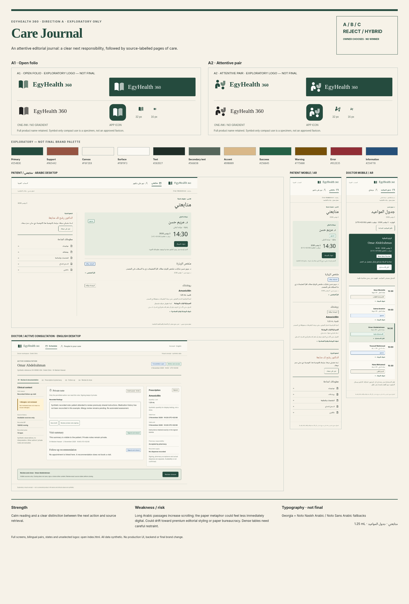
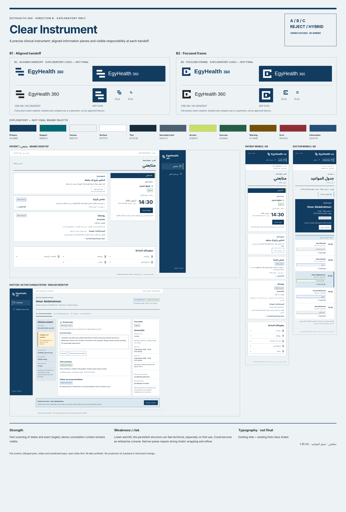
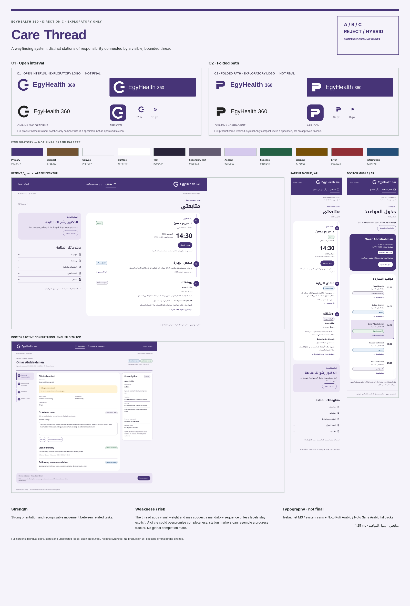
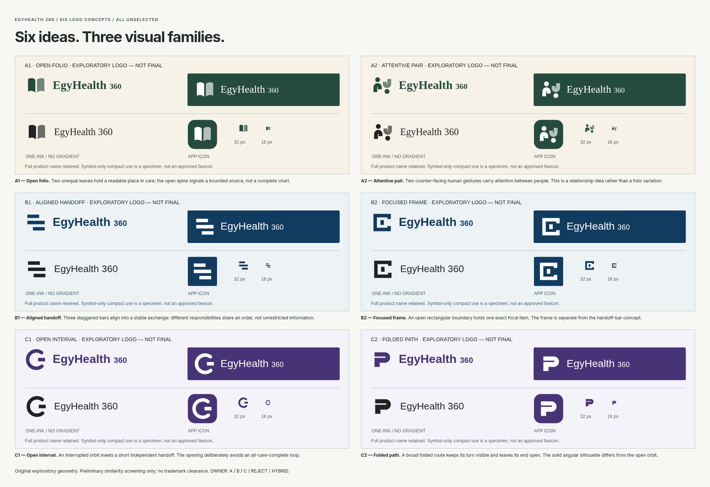

# EgyHealth 360 — exactly three visual directions

**EXPLORATORY VISUAL REVIEW — NOT FINAL BRAND / NOT DESIGN SYSTEM / NOT PRODUCTION UI.**

Authority: [Issue #72 comment 6568574368](https://github.com/abuhmaid28/egyhealth360/issues/72#issuecomment-6568574368). Base main: `0a0e9c2038ecad420e95c2c67ae367129e195839`. Accepted UX, IA01–IA05, CD01–CD07 and BR01–BR08 are preserved. No winner selected.

Open [index.html](index.html) from a checked-out repository in a browser. No build, app, backend, external network or dependency installation is needed to review. GitHub shows the PNG/SVG previews below; GitHub's HTML source viewer does not execute the page, so download/checkout the repository to use its local navigation. All product controls are static appearance specimens, with no mutations. Only owner-review navigation is linked.

## Direction A — Care Journal

[A review](direction-a/index.html) · [A1 Open folio](logos/a1-proof.svg) · [A2 Attentive pair](logos/a2-proof.svg). Warm editorial paper, open margins and serif/Naskh rhythm. Strength: calm reading and clear next responsibility. Weakness: longer Arabic pages and a risk of paper bureaucracy.

## Direction B — Clear Instrument

[B review](direction-b/index.html) · [B1 Aligned handoff](logos/b1-proof.svg) · [B2 Focused frame](logos/b2-proof.svg). Dark rail, squared work planes and compact concurrent clinical panes. Strength: scan clarity and dense context. Weakness: a more technical feel and narrow-pane Arabic wrapping risk.

## Direction C — Care Thread

[C review](direction-c/index.html) · [C1 Open interval](logos/c1-proof.svg) · [C2 Folded path](logos/c2-proof.svg). Indigo wayfinding, a continuous white lane and open station spine. Strength: recognizable orientation. Weakness: the thread may imply a compulsory sequence unless copy remains explicit.

## All six logo concepts

## Full-size screen inventory

Each direction has the same seven screen pairs in both `ar` and `en`: 14 HTML specimens and 14 PNG exports per direction; **42 full screen exports total**. Desktop is 1440px wide; mobile is a genuine 390px reflow. Screen names are identical within each direction folder.

| File stem | Purpose | Required proof |
| --- | --- | --- |
| `patient-{ar,en}` | Patient My care / متابعتي | Next appointment, shared summary, follow-up recommendation, signed prescription, bounded retrieval |
| `patient-mobile-{ar,en}` | Patient mobile My care | Complete Arabic/English reading and secondary retrieval |
| `appointment-{ar,en}` | Patient appointment context | Doctor, clinic, date/time/zone and booking versus care permission |
| `schedule-{ar,en}` | Doctor Schedule / جدول المواعيد | Populated dated workload and distinct appointment states |
| `consultation-{ar,en}` | Active Consultation | Stable patient/visit/access context; private documentation; shared summary; prescription/validity; follow-up; review/close |
| `doctor-mobile-{ar,en}` | Responsive Doctor context | Schedule and exact visit review; dense prescribing is not mechanically squeezed to mobile |
| `states-{ar,en}` | State and consequence board | Normal, empty, loading, error, unavailable, success, warning and uncertain result |

Every file stem has `.html` and `.png`. The direction review pages link each exact file at full size. No need to inspect source to judge the designs.

- [Unranked matrix](comparison/MATRIX.md) · [visual comparison](comparison/index.html) · [logo-free proof](comparison/logo-free-comparison.png).
- [All six logo rationales / risks](logos/REVIEW.md).
- [Validation, accessibility and semantic safety](evidence/VALIDATION.md) · [machine render record](evidence/render-results.json).
- [Shared synthetic facts](evidence/synthetic-fixture.json) · [exploratory direction specifications](evidence/direction-data.json).

## Reproduce the isolated artifacts

`python docs/visual-directions/generate-review.py` regenerates HTML/SVG from standard-library Python only. It does not edit the application. PNG generation uses `node docs/visual-directions/render-review.mjs` with the repository's already declared Playwright dependency and system Chromium; optional `VISUAL_PLAYWRIGHT_MODULE` and `VISUAL_CHROMIUM` select installed tools without changing repository dependencies. The renderer uses a temporary read-only loopback static server because managed Chromium blocks `file:` navigation; it starts/stops inside the render command. This is capture tooling, not a delivered app backend. No font binaries are added: existing Inter/Noto Sans Arabic are referenced, with browser/system Naskh/Kufi/serif/sans fallbacks. Rendering may vary by system font availability; committed PNGs preserve this review's actual output. The review page itself needs neither Python nor Node.

## Product Owner decision required

**A / B / C / REJECT / HYBRID**

For HYBRID, name elements explicitly, for example: Logo B2 + Patient UI A + Doctor density C + Color philosophy B. A coherent hybrid must be rendered later and approved; this does not automatically create Final Brand V2. Final logo, palette, font, brand, Design System, prototypes and frontend implementation retain their separate gates. PR remains open/unmerged with auto-merge off.
