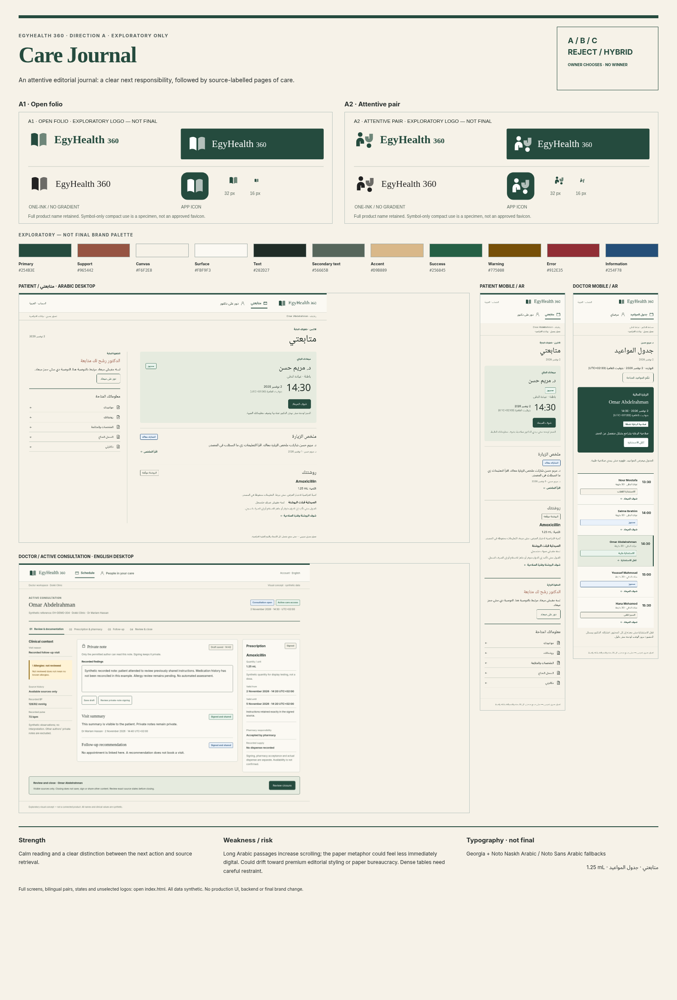

# Direction A — Care Journal

EXPLORATORY ONLY. An attentive editorial journal: a clear next responsibility, followed by source-labelled pages of care.

[Open review page](index.html) · [Concept sheet and comparisons](../comparison/MATRIX.md) · [Logo review](../logos/REVIEW.md).

- Strength: Calm reading and a clear distinction between the next action and source retrieval.
- Weakness: Long Arabic passages increase scrolling; the paper metaphor could feel less immediately digital.
- Risk: Could drift toward premium editorial styling or paper bureaucracy. Dense tables need careful restraint.

A / B / C / REJECT / HYBRID. No winner, final logo, final palette or final font selected.
