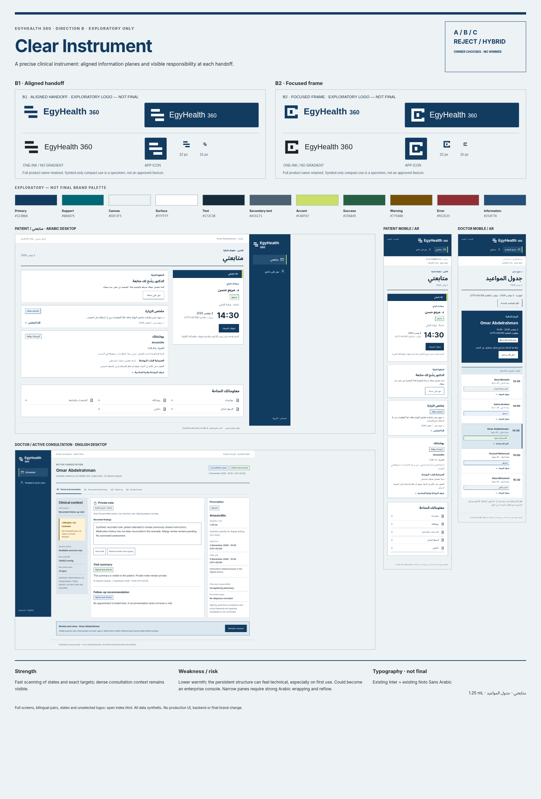

# Direction B — Clear Instrument

EXPLORATORY ONLY. A precise clinical instrument: aligned information planes and visible responsibility at each handoff.

[Open review page](index.html) · [Concept sheet and comparisons](../comparison/MATRIX.md) · [Logo review](../logos/REVIEW.md).

- Strength: Fast scanning of states and exact targets; dense consultation context remains visible.
- Weakness: Lower warmth; the persistent structure can feel technical, especially on first use.
- Risk: Could become an enterprise console. Narrow panes require strong Arabic wrapping and reflow.

A / B / C / REJECT / HYBRID. No winner, final logo, final palette or final font selected.
