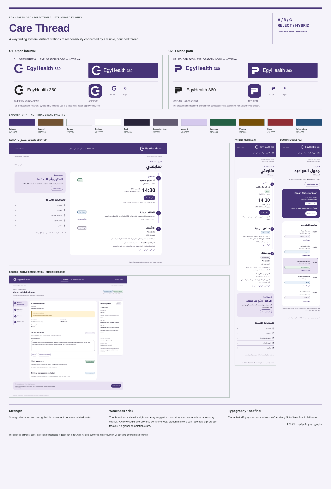

# Direction C — Care Thread

EXPLORATORY ONLY. A wayfinding system: distinct stations of responsibility connected by a visible, bounded thread.

[Open review page](index.html) · [Concept sheet and comparisons](../comparison/MATRIX.md) · [Logo review](../logos/REVIEW.md).

- Strength: Strong orientation and recognizable movement between related tasks.
- Weakness: The thread adds visual weight and may suggest a mandatory sequence unless labels stay explicit.
- Risk: A circle could overpromise completeness; station markers can resemble a progress tracker. No global completion state.

A / B / C / REJECT / HYBRID. No winner, final logo, final palette or final font selected.
